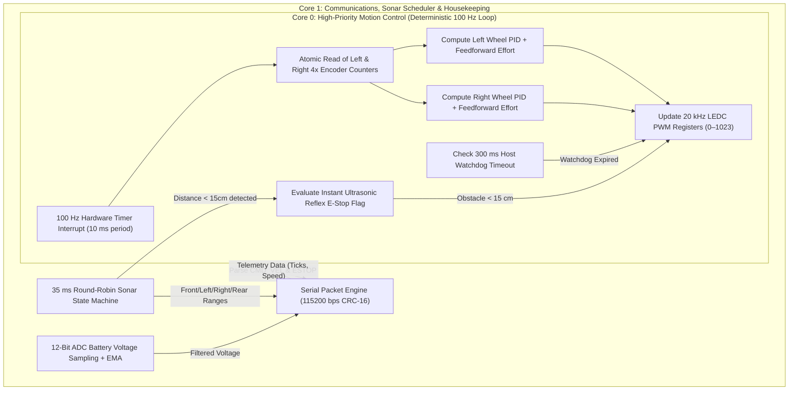
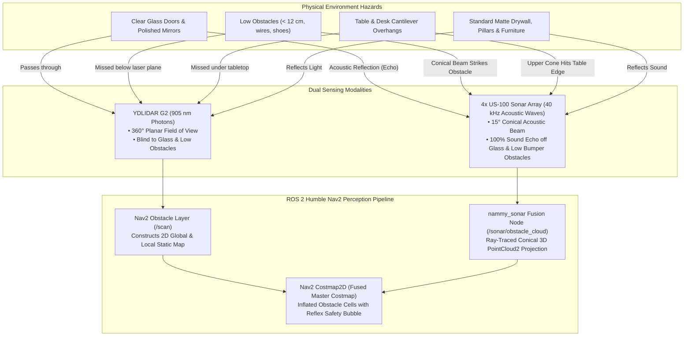

# Hotel Serving Robot (Nammy Robot)

[](https://docs.ros.org/en/humble/)
[](https://developer.nvidia.com/embedded/jetson-orin)
[](https://www.espressif.com/en/products/socs/esp32-s3)
[](https://platformio.org/)
[](LICENSE)
[](SECURITY.md)
[](mailto:namanharshwal@gmail.com)
[](LICENSE)

---

## Master Engineering & Production Documentation

* **Project Architect, Author & Sole Copyright Holder:** Naman Harshwal  
* **Official Contact:** [namanharshwal@gmail.com](mailto:namanharshwal@gmail.com)  
* **GitHub Repository:** [https://github.com/namanharshwal/Hotel_Serving_Robot](https://github.com/namanharshwal/Hotel_Serving_Robot)  
* **High-Level Compute SBC:** NVIDIA Jetson Orin Nano Super Developer Kit (8GB RAM, NVMe SSD)  
* **Real-Time Motion & Safety Mediator:** ESP32-S3-DevKitC-1 (Xtensa 32-bit Dual-Core LX7 @ 240 MHz)  
* **Robotics Middleware:** ROS 2 Humble Hawksbill (Ubuntu 22.04 LTS / JetPack 6.x)  
* **Network Domain Isolation:** `ROS_DOMAIN_ID=42` (Guaranteed 100% isolation from `hover_ws` and other robots)  
* **Local Workspace Root:** `/home/comppoint/Documents/nammy_ws` (symlinked at `/home/comppoint/nammy_ws`)  
* **License:** Apache License, Version 2.0  

---

## Table of Contents
1. [Executive Summary & System Architecture](#1-executive-summary--system-architecture)
2. [Visual Architecture Diagrams](#2-visual-architecture-diagrams)
   - [2.1 Complete Hardware Topology Diagram](#21-complete-hardware-topology-diagram)
   - [2.2 ROS 2 Node Computation & Message Graph](#22-ros-2-node-computation--message-graph)
   - [2.3 Dual-Core FreeRTOS Mediator Architecture](#23-dual-core-freertos-mediator-architecture)
   - [2.4 Multi-Physics Sensor Fusion (LiDAR + 4x Sonar)](#24-multi-physics-sensor-fusion-lidar--4x-sonar)
3. [Component Bill of Materials (BOM) & Direct Sources](#3-component-bill-of-materials-bom--direct-sources)
4. [Deep Architectural Rationale & Sensor Allocations](#4-deep-architectural-rationale--sensor-allocations)
   - [4.1 BNO055 IMU: Jetson 40-Pin I2C vs. ESP32-S3](#41-bno055-imu-jetson-40-pin-i2c-vs-esp32-s3)
   - [4.2 4x US-100 Sonar Array: ESP32-S3 vs. Jetson Linux](#42-4x-us-100-sonar-array-esp32-s3-vs-jetson-linux)
   - [4.3 YDLIDAR G2: Direct Jetson High-Speed USB Link](#43-ydlidar-g2-direct-jetson-high-speed-usb-link)
   - [4.4 Complementary LiDAR + Sonar Multi-Physics Fusion](#44-complementary-lidar--sonar-multi-physics-fusion)
5. [Complete Electrical Wiring Diagrams & Interconnection Matrix](#5-complete-electrical-wiring-diagrams--interconnection-matrix)
   - [5.1 Master System Electrical Schematic](#51-master-system-electrical-schematic)
   - [5.2 Pin-by-Pin Connection Matrix](#52-pin-by-pin-connection-matrix)
   - [5.3 Logic Level Shifter (TXS0108E) Wiring & Jumper Setup](#53-logic-level-shifter-txs0108e-wiring--jumper-setup)
   - [5.4 Power Distribution & Star Ground Topology](#54-power-distribution--star-ground-topology)
6. [Mathematical Kinematics & Sub-Millimeter Odometry](#6-mathematical-kinematics--sub-millimeter-odometry)
   - [6.1 Physical Parameters & Encoder Resolution Calculation](#61-physical-parameters--encoder-resolution-calculation)
   - [6.2 Inverse & Forward Kinematics Formulations](#62-inverse--forward-kinematics-formulations)
   - [6.3 Runge-Kutta 2nd-Order Odometry Integration](#63-runge-kutta-2nd-order-odometry-integration)
7. [The 10 Modular ROS 2 Component Packages](#7-the-10-modular-ros-2-component-packages)
8. [End-to-End Installation & Setup Walkthrough (From Scratch)](#8-end-to-end-installation--setup-walkthrough-from-scratch)
   - [Step 1: System Prerequisites & Base Dependencies](#step-1-system-prerequisites--base-dependencies)
   - [Step 2: Clone the Repository](#step-2-clone-the-repository)
   - [Step 3: Isolated Python Virtual Environment & Requirements](#step-3-isolated-python-virtual-environment--requirements)
   - [Step 4: Hardware Udev Rules Installation](#step-4-hardware-udev-rules-installation)
   - [Step 5: PlatformIO Firmware Compilation & Flashing](#step-5-platformio-firmware-compilation--flashing)
   - [Step 6: ROS 2 Workspace Build](#step-6-ros-2-workspace-build)
   - [Step 7: Workspace Environment Activation](#step-7-workspace-environment-activation)
9. [Pre-Flight Hardware Diagnostics & Verification Suite](#9-pre-flight-hardware-diagnostics--verification-suite)
10. [Launching the Full Autonomous Stack](#10-launching-the-full-autonomous-stack)
11. [Multi-Tier Safety Systems & Reflex Braking](#11-multi-tier-safety-systems--reflex-braking)
12. [Enterprise Security Architecture & System Hardening](#12-enterprise-security-architecture--system-hardening)
    - [12.1 SROS2 & DDS-Security Specification (PKI & Wire Encryption)](#121-sros2--dds-security-specification-pki--wire-encryption)
    - [12.2 Linux Host & Network Hardening (UFW & Sysctl)](#122-linux-host--network-hardening-ufw--sysctl)
    - [12.3 Real-Time Hardware & Firmware Hardening](#123-real-time-hardware--firmware-hardening)
    - [12.4 Automated Static Security Audit Tool](#124-automated-static-security-audit-tool)
13. [Troubleshooting & Frequently Asked Questions (FAQ)](#13-troubleshooting--frequently-asked-questions-faq)
14. [Authorship & Intellectual Property Notice](#14-authorship--intellectual-property-notice)

---

## 1. Executive Summary & System Architecture

The **Hotel Serving Robot (Nammy Robot)** is an industrial-grade, heavy-payload differential drive Autonomous Mobile Robot (AMR) designed, developed, and maintained by **Naman Harshwal**. The system is engineered to navigate dynamic indoor hotel, restaurant, and hospital environments with absolute precision, zero collision risk, and sub-millimeter dead-reckoning accuracy.

The robot features a **two-tier compute and control architecture**:
1. **High-Level Compute Layer (NVIDIA Jetson Orin Nano Super):**
   - 6-core ARM Cortex-A78AE CPU + 1024-core NVIDIA Ampere GPU with 32 Tensor Cores.
   - Runs full ROS 2 Humble Hawksbill on JetPack 6.x / Ubuntu 22.04 LTS.
   - Handles Cartographer / SLAM Toolbox mapping, Nav2 autonomous costmaps, global/local path planning, BNO055 9-DOF IMU EKF fusion via `robot_localization`, and a 10.1" Capacitive Touch HMI dashboard.
2. **Low-Level Real-Time Mediator Layer (ESP32-S3-DevKitC-1):**
   - 32-bit Dual-Core Xtensa LX7 MCU @ 240 MHz.
   - Deterministic 100 Hz closed-loop PID velocity control with feedforward acceleration shaping.
   - 20 kHz silent ultrasonic PWM driving dual SmartElex 30A motor controllers.
   - Microsecond hardware decoding of 4x optical quadrature encoders (6,000 counts per wheel revolution).
   - 35 ms round-robin acoustic pulsing of 4x US-100 ultrasonic sensors via a TXS0108E high-speed level shifter.
   - Autonomous hardware reflex braking (< 10 ms stop) when obstacles breach the critical 15 cm threshold.
   - 300 ms communications watchdog timer auto-braking motors if the Jetson link stalls.
   - Continuous 12-bit ADC monitoring of the 24V LiFePO4 battery pack with exponential moving average (EMA) filtering.

---

## 2. Visual Architecture Diagrams

### 2.1 Complete Hardware Topology Diagram

```mermaid
flowchart TD
    subgraph POWER_BAY ["Power Supply & Distribution Bay"]
        BAT["24V 15Ah LiFePO4 8S Battery Pack<br/>(25.6V Nom, 29.2V Peak, 380Wh, 20A BMS)"]
        FUSE["20A Inline Fuse & Safety Kill Switch"]
        BUCK1["DC-DC Step-Down Buck<br/>(24V to 19V @ 5A / 95W)"]
        BUCK2["DC-DC Step-Down Buck<br/>(24V to 5.1V @ 5A / 25W)"]
        VDIV["100k / 10k Precision Voltage Divider<br/>(11:1 Attenuation, 0–3.0V)"]
    end

    subgraph JETSON_SBC ["High-Level Compute Layer: NVIDIA Jetson Orin Nano Super"]
        J_CORE["Jetson Orin Nano Super (8GB RAM, NVMe)<br/>Ubuntu 22.04 LTS + ROS 2 Humble"]
        J_I2C["I2C Bus 7 (/dev/i2c-7, Pins 27/28)"]
        J_USB1["USB 3.0 High-Speed Port"]
        J_USB2["USB 3.0 High-Speed Port"]
        J_HDMI["HDMI Port (1280x800)"]
    end

    subgraph SENSORS_JETSON ["Direct Jetson Sensors & HMI"]
        BNO["Bosch BNO055 9-DOF IMU<br/>(Hardware BSX3.0 Quaternions)"]
        LIDAR["YDLIDAR G2 360° 2D Laser Scanner<br/>(9 kHz Sample Rate, 12m Range, 10 Hz)"]
        SCREEN["10.1 Inch IPS Capacitive Touch Display<br/>(1280x800 Resolution, MicroUSB Touch)"]
    end

    subgraph ESP32_MEDIATOR ["Real-Time Mediator Layer: ESP32-S3 DevKitC-1 (240 MHz)"]
        MCU["ESP32-S3 Dual-Core LX7<br/>FreeRTOS Deterministic Control"]
        ADC_CH["GPIO 1: 12-Bit ADC Battery Monitor"]
        LEDC["LEDC Timers: 20 kHz Silent PWM"]
        QDEC["Hardware ISR Pulse Counters (4x)"]
        SONAR_SCHED["35ms Round-Robin Sonar Scheduler"]
    end

    subgraph MOTOR_DRIVE ["Drive Subsystem"]
        SE_L["SmartElex 30S Driver (Left)<br/>30A Cont / 85A Peak"]
        SE_R["SmartElex 30S Driver (Right)<br/>30A Cont / 85A Peak"]
        MOT_L["AT120 24V DC Left Motor<br/>15:1 Planetary Reducer"]
        MOT_R["AT120 24V DC Right Motor<br/>15:1 Planetary Reducer"]
        ENC_L["Optical Quadrature Encoder (Left)<br/>100 PPR (1,500 PPR shaft)"]
        ENC_R["Optical Quadrature Encoder (Right)<br/>100 PPR (1,500 PPR shaft)"]
        WHEEL_L["100mm HD Disc Wheel (Left)"]
        WHEEL_R["100mm HD Disc Wheel (Right)"]
    end

    subgraph ULTRASONIC_ARRAY ["Bumper Acoustic Safety Subsystem"]
        SHIFTER["TXS0108E 8-Channel High Speed Level Shifter<br/>Side A: 3.3V <===> Side B: 5.0V"]
        SONAR_F["Front US-100 Sonar (40 kHz, 15° cone)"]
        SONAR_L["Left US-100 Sonar (40 kHz, 15° cone)"]
        SONAR_R["Right US-100 Sonar (40 kHz, 15° cone)"]
        SONAR_B["Rear US-100 Sonar (40 kHz, 15° cone)"]
    end

    %% Power Links
    BAT --> FUSE
    FUSE -->|"24V Raw High-Current"| SE_L
    FUSE -->|"24V Raw High-Current"| SE_R
    FUSE -->|"24V Raw"| BUCK1
    FUSE -->|"24V Raw"| BUCK2
    FUSE -->|"24V Sense"| VDIV
    VDIV -->|"0–3.0V Analog"| ADC_CH
    BUCK1 -->|"19V Regulated DC"| J_CORE
    BUCK2 -->|"5.1V Logic & Sensors"| SCREEN
    BUCK2 -->|"5.0V VCCB"| SHIFTER
    BUCK2 -->|"5.0V VCC"| SONAR_F & SONAR_L & SONAR_R & SONAR_B

    %% Jetson Sensor Links
    J_I2C <-->|"I2C Bus 7 (Clock Stretching OK)"| BNO
    J_USB1 <-->|"USB-Serial 230,400 baud"| LIDAR
    J_HDMI -->|"1280x800 Video"| SCREEN
    J_USB2 <-->|"MicroUSB Touch HID"| SCREEN

    %% Jetson to ESP32 Link
    J_CORE <-->|"Shielded USB Type-C (115,200 baud CRC-16 Packet Protocol)"| MCU

    %% ESP32 to Motor Drivers
    LEDC -->|"GPIO 4 (PWM) & GPIO 5 (DIR)"| SE_L
    LEDC -->|"GPIO 6 (PWM) & GPIO 7 (DIR)"| SE_R
    SE_L -->|"24V High Current Armature"| MOT_L
    SE_R -->|"24V High Current Armature"| MOT_R
    MOT_L --> WHEEL_L
    MOT_R --> WHEEL_R

    %% Encoders to ESP32
    MOT_L -.-> ENC_L
    MOT_R -.-> ENC_R
    ENC_L -->|"GPIO 15 (A) & GPIO 16 (B)"| QDEC
    ENC_R -->|"GPIO 17 (A) & GPIO 18 (B)"| QDEC

    %% Ultrasonic Array Links
    SONAR_SCHED <-->|"GPIO 8–14, 21 (3.3V Logic)"| SHIFTER
    SHIFTER <-->|"5.0V Trigger & Echo"| SONAR_F
    SHIFTER <-->|"5.0V Trigger & Echo"| SONAR_L
    SHIFTER <-->|"5.0V Trigger & Echo"| SONAR_R
    SHIFTER <-->|"5.0V Trigger & Echo"| SONAR_B
```



---

### 2.2 ROS 2 Node Computation & Message Graph

```mermaid
flowchart LR
    subgraph TELEOP_HMI ["User & Autonomous Navigation Interfaces"]
        JOY["nammy_teleop<br/>(Keyboard / Joy)"]
        NAV2["Nav2 Stack / Costmap2D<br/>(Path Planner & Controller)"]
        HMI["nammy_display<br/>(10.1\" Touchscreen GUI)"]
    end

    subgraph DRIVER_NODES ["Hardware Driver & Bridge Layer"]
        BRIDGE["nammy_base<br/>(esp32_hardware_bridge)"]
        IMU_NODE["nammy_imu<br/>(bno055_node)"]
        LIDAR_NODE["nammy_lidar<br/>(ydlidar_ros2_driver_node)"]
    end

    subgraph FILTER_FUSION ["State Estimation & Sensory Fusion"]
        SONAR_NODE["nammy_sonar<br/>(sonar_fusion_node)"]
        POWER_NODE["nammy_power<br/>(battery_monitor_node)"]
        MOTOR_MGR["nammy_motors<br/>(motor_manager)"]
        ROBOT_STATE["robot_state_publisher<br/>(nammy_description URDF)"]
    end

    %% Message Topic Connections
    JOY -->|"/cmd_vel"| MOTOR_MGR
    NAV2 -->|"/cmd_vel"| MOTOR_MGR
    HMI -->|"/cmd_vel & /nammy/estop"| MOTOR_MGR

    MOTOR_MGR -->|"/cmd_vel_safe"| BRIDGE

    BRIDGE -->|"/odom (50 Hz)"| NAV2
    BRIDGE -->|"/joint_states"| ROBOT_STATE
    BRIDGE -->|"/nammy/battery_state"| POWER_NODE
    BRIDGE -->|"/sonar/front, left, right, rear"| SONAR_NODE
    BRIDGE -->|"TF: odom -> base_footprint"| NAV2

    IMU_NODE -->|"/imu/data (50 Hz)"| NAV2
    LIDAR_NODE -->|"/scan (10 Hz, 360°)"| NAV2
    SONAR_NODE -->|"/sonar/obstacle_cloud"| NAV2
    SONAR_NODE -->|"/nammy/sonar_safety_stop"| MOTOR_MGR
    POWER_NODE -->|"/diagnostics & alerts"| HMI
```

---

### 2.3 Dual-Core FreeRTOS Mediator Architecture

The ESP32-S3 Xtensa LX7 dual-core processor is partitioned to isolate high-speed motor control from non-blocking sensor acquisition:



---

### 2.4 Multi-Physics Sensor Fusion (LiDAR + 4x Sonar)

Differential drive mobile robots in indoor hotel environments face major hazards that traditional 2D planar LiDAR cannot detect:
1. **Glass Windows & Full-Length Mirrors:** Laser photons (905 nm) transmit directly through transparent glass or reflect away from mirrors at specular angles, rendering glass invisible to LiDAR.
2. **Floor Drop-Offs & Stairs:** A horizontally mounted LiDAR scans parallel to the ground (typically at 200 mm height) and cannot see downward steps.
3. **Low-Profile Obstacles & Overhangs:** Items lower than 120 mm (shoes, wires, bags) or table overhangs pass underneath or above the single-plane laser scan line.



---

## 3. Component Bill of Materials (BOM) & Direct Sources

Every component in the Hotel Serving Robot was rigorously selected for industrial-duty 24/7 reliability, thermal stability, and exact electrical compatibility:

| Component | Engineering Specifications & Ratings | Procurement Source |
| :--- | :--- | :--- |
| **Motor Drivers (2x)** | **SmartElex 30S Single Channel 30A DC Motor Driver**<br>• Input Voltage: 7V to 28V DC (24V Nominal)<br>• Current: 30A Continuous, 85A Peak (2 seconds)<br>• Control: 3.3V/5V TTL PWM & Direction Input<br>• Protection: Overcurrent, Under-Voltage Lockout (UVLO), Status LEDs | [Robocraze SmartElex 30S Driver](https://robocraze.com/products/smartelex-30s-single-channel-30a-dc-motor-driver?variant=48113148231904) |
| **Battery Pack** | **24V ~15Ah LiFePO4 (LFP) 8S Battery Pack (380Wh)**<br>• Chemistry: Lithium Iron Phosphate (32140-3.2V 15Ah A-Grade Cells)<br>• Voltage: 25.6V Nominal, 29.2V Full Charge, 20.0V Cutoff<br>• BMS: Integrated 20A TDT BMS with balance charging<br>• Endurance: 2,000+ Full Discharge Cycles | [Amazon India 24V 15Ah LFP Battery](https://amzn.in/d/09jY1yoz) |
| **Touch Display** | **10.1" Capacitive Touch Display 1280x800 IPS HDMI**<br>• SKU: WVSH0067 (Waveshare / ThinkRobotics)<br>• Active Area: 1280 × 800 pixels (16:10 aspect ratio), 178° IPS<br>• Interface: Standard HDMI Video + MicroUSB Multi-Touch Capacitive HID<br>• Power: 5V DC via MicroUSB port | [ThinkRobotics 10.1" Touch Display](https://tkro.in/7bnxz) |
| **Drive Wheels (2x)** | **Heavy Duty HD Disc Wheel 100mm Diameter**<br>• Diameter: 100 mm ($r = 0.050\text{ m}$), Width: 35 mm<br>• Tread: High-traction, shock-absorbing polyurethane solid rubber<br>• Core: Reinforced HD disc hub with standard motor shaft adapter | [Robu.in 100mm HD Disc Wheel](https://robu.in/product/heavy-dutyhd-disc-wheel-100mm-dia-1pcgrey-color) |
| **Microcontroller** | **ESP32-S3-DevKitC-1 Wireless Development Board**<br>• MCU: ESP32-S3 (Xtensa 32-bit Dual-Core LX7 @ 240 MHz, 512KB SRAM, 8MB Flash)<br>• Interfaces: Dual Type-C USB (UART + Native USB OTG CDC), Hardware LEDC PWM, Pulse Counter<br>• Wireless: 2.4 GHz Wi-Fi + Bluetooth 5 (LE) | [Probots ESP32-S3 DevKitC-1](https://probots.co.in/esp32-s3-devkitc-1-development-board-wireless-module-wifi-bluetooth.html) |
| **DC Gear Motors (2x)** | **AT120 Otis PAX DC Gear Motors with Encoder (KM949299)**<br>• Voltage: 24V DC Rated<br>• Gear Transmission: 15:1 Integrated Planetary Reduction<br>• Speed: ~200 RPM rated output ($\approx 20.94\text{ rad/s}$)<br>• Torque: ~1.05–1.08 N·m continuous, heavy peak torque<br>• Feedback: Dual-channel optical incremental encoder (100 pulses/rev) | [Kone / Otis AT120 Motor (KM949299)](https://share.google/D32h0ckD8dXbc6RLv) |
| **Ultrasonic Sensors (4x)**| **US-100 Ultrasonic Distance Measuring Sensor Module**<br>• Operating Voltage: 2.4V to 5.5V DC (Configured at 5.0V)<br>• Range: 2 cm to 450 cm (4.5m)<br>• Integrated Temperature Compensation for speed-of-sound accuracy<br>• Operating Mode: Jumper REMOVED for Trigger/Echo pulse mode | [Robu.in US-100 Ultrasonic Sensor](https://robu.in/product/us-100-ultrasonic-sensor-distance-measuring-module-temperature-compensation/) |
| **Logic Level Shifter**| **TXS0108E High Speed Full Duplex 8-Channel Logic Level Converter**<br>• Channels: 8 Bidirectional auto-direction sensing channels<br>• Voltage Rails: Port A = 1.2V–3.6V (3.3V ESP32), Port B = 1.65V–5.5V (5.0V US-100)<br>• Speed: Up to 60 Mbps push-pull / 2 Mbps open-drain | [ElectroPi TXS0108E Level Converter](https://share.google/e0HAv8aUK5kFdkajV) |
| **2D Laser Scanner** | **YDLIDAR G2 360-Degree 2D LiDAR**<br>• Scan Frequency: 5–12 Hz (Configured at 10 Hz)<br>• Sample Rate: 5,000–9,000 samples/sec (9 kHz)<br>• Range: 0.12m to 12.0m, Angular Resolution: 0.4°–0.6°<br>• Interface: USB Type-C (Silicon Labs CP2102 @ 230,400 baud) | Standard YDLIDAR G2 Scanner |
| **9-DOF IMU Sensor** | **Bosch BNO055 9-Axis Absolute Orientation Sensor**<br>• Output: Triaxial 14-bit Accelerometer, 16-bit Gyroscope, Geomagnetic Field Sensor<br>• Onboard Fusion: BSX3.0 FusionLib Cortex-M0 MCU outputting absolute Quaternions<br>• Interface: I2C (Address: 0x28 or 0x29) with Clock Stretching | Standard Bosch BNO055 breakout |

---

## 4. Deep Architectural Rationale & Sensor Allocations

### 4.1 BNO055 IMU: Jetson 40-Pin I2C vs. ESP32-S3

A critical architectural decision in autonomous robotics is where to connect the 9-DOF IMU:

| Evaluation Criteria | Jetson 40-Pin I2C Bus 7 (Selected Standard) | ESP32-S3 Microcontroller | Engineering Verdict |
| :--- | :--- | :--- | :--- |
| **I2C Clock Stretching Jitter** | The Jetson Tegra SoC hardware I2C controller natively supports clock stretching without stalling OS threads. | BNO055 holds SCL low for 450–1200 $\mu$s during sensor fusion calculation. If connected to ESP32, this introduces severe jitter into the 100 Hz PID motor loop. | 🏆 **Jetson 40-Pin** |
| **EKF & Nav2 Latency** | Direct in-memory delivery to ROS 2 `robot_localization` node. Zero transmission latency. | Must serialize 40 bytes over serial, parse CRC-16, and republish, adding 15–30 ms latency to heading feedback. | 🏆 **Jetson 40-Pin** |
| **EMI / High-Current Noise** | Logic bay on top deck is physically isolated from motor power rails. | I2C traces routed near the ESP32 and SmartElex drivers risk bus lockups from inductive spikes. | 🏆 **Jetson 40-Pin** |
| **Driver Package** | Directly driven by our optimized ROS 2 Humble node [`nammy_imu`](src/nammy_imu). | Requires embedded driver inside ESP32 firmware, bloating flash and RAM. | 🏆 **Jetson 40-Pin** |

> **Conclusion:** The BNO055 is connected directly to **Jetson 40-Pin Header I2C Bus 7 (Pins 27 & 28)**.

---

### 4.2 4x US-100 Sonar Array: ESP32-S3 vs. Jetson Linux

Why the 4 ultrasonic distance sensors **MUST NOT** be connected directly to the Jetson GPIO:
1. **Microsecond Precision vs. Linux Kernel Preemption:**
   Ultrasonic measurement relies on timing acoustic travel times at the speed of sound ($c = 343\text{ m/s} \implies 58.2\ \mu\text{s/cm}$). On a non-real-time Linux OS like Ubuntu, CPU context switches, graphics driver spikes, or disk I/O cause random multi-millisecond thread delays. A single 1 ms timing error results in a **17.1 cm distance error**. The ESP32-S3 runs FreeRTOS with microsecond hardware timer resolution (`micros()`), delivering sub-millimeter ranging repeatability.
2. **Deterministic Round-Robin Crosstalk Suppression:**
   Firing 4 ultrasonic sensors simultaneously in an enclosed corridor causes acoustic crosstalk: sonar pulses bouncing diagonally off walls trigger false echoes on adjacent receivers. The ESP32-S3 enforces a deterministic 35 ms round-robin firing sequence (Front $\rightarrow$ Left $\rightarrow$ Right $\rightarrow$ Rear $\rightarrow$ repeat), ensuring all echoes decay before the next pulse.
3. **Autonomous Reflex Braking (< 10 ms Fail-Safe):**
   If a pedestrian steps directly in front of the robot or a clear glass door is encountered at 15 cm, the ESP32-S3 immediately zeroes the motor PWM within **< 10 ms**, completely bypassing the Jetson, ROS 2, or USB serial latency.

---

### 4.3 YDLIDAR G2: Direct Jetson High-Speed USB Link

The YDLIDAR G2 generates 9,000 range points per second at a continuous 230,400 baud serial stream (10 Hz 360° scans). It is connected directly to the Jetson Orin Nano Super USB 3.0 port:
* The Jetson's 6-core ARM CPU and Ampere GPU possess the computational bandwidth required for real-time laser scan filtering, scan matching, Cartographer 2D submap generation, and Nav2 Costmap2D inflation.
* Connecting the LiDAR to the microcontroller would completely overwhelm the ESP32 memory and bus bandwidth.

---

### 4.4 Complementary LiDAR + Sonar Multi-Physics Fusion

| Operational Scenario | YDLIDAR G2 (Planar Laser) | 4x US-100 Ultrasonic Array | Fused Robot Behavior |
| :--- | :--- | :--- | :--- |
| **Glass Walls & Automatic Doors** | **BLIND** (905 nm photons pass through clear glass) | **100% REFLECTED** (Sound waves bounce off rigid glass surface) | Sonar detects glass barrier; robot stops safely |
| **Mirrors & Polished Chrome** | **BLIND** (Specular light reflection deflects away from receiver) | **100% REFLECTED** (Acoustic impedance mismatch creates echo) | Sonar detects mirror; Nav2 injects costmap obstacle |
| **Low Obstacles (< 12 cm)** | **BLIND** (Laser plane scans horizontally at 200 mm height) | **DETECTED** (15° conical beam sweeps from floor to bumper) | Protects wheels from rolling over cables, feet, toys |
| **Table & Chair Overhangs** | **BLIND** (Laser passes under tabletop) | **DETECTED** (Upper cone edge strikes table overhang) | Prevents robot head from jamming under tables |
| **Long-Range Mapping (0.5m–12m)** | **EXCELLENT** (Millimeter range accuracy, 0.5° angular res) | **POOR** (Beam spreads into wide 15° cone, max 4.5m) | LiDAR provides sharp global geometry for SLAM |

---

## 5. Complete Electrical Wiring Diagrams & Interconnection Matrix

### 5.1 Master System Electrical Schematic

```
========================================================================================================
                                     NAMMY ROBOT MASTER WIRING SCHEMATIC
========================================================================================================

                                  +---------------------------------------+
                                  | 24V 15Ah LiFePO4 (LFP) 8S Battery     |
                                  | (25.6V Nom, 29.2V Full, 20.0V Cutoff) |
                                  +-------------------+-------------------+
                                                      |
                                          [ 20A Fuse & Kill Switch ]
                                                      |
                 +------------------------------------+------------------------------------+
                 | +24V Raw High-Current Bus                 | GND Common Ground Bus      |
                 |                                           |                            |
                 v                                           v                            |
+---------------------------------+         +---------------------------------+           |
| SmartElex 30S (Left Driver)     |         | SmartElex 30S (Right Driver)    |           |
|   B+ : +24V Battery Bus         |         |   B+ : +24V Battery Bus         |           |
|   B- : Ground Bus (GND)         |         |   B- : Ground Bus (GND)         |           |
|   M1 : Left Motor (+)           |         |   M1 : Right Motor (+)          |           |
|   M2 : Left Motor (-)           |         |   M2 : Right Motor (-)          |           |
|   PWM: <-- ESP32-S3 GPIO 4      |         |   PWM: <-- ESP32-S3 GPIO 6      |           |
|   DIR: <-- ESP32-S3 GPIO 5      |         |   DIR: <-- ESP32-S3 GPIO 7      |           |
|   GND: Logic GND                |         |   GND: Logic GND                |           |
+---------------------------------+         +---------------------------------+           |
                 |                                           |                            |
                 +--------------------+----------------------+                            |
                                      |                                                   |
                 +--------------------+----------------------+                            |
                 |                                           |                            |
                 v                                           v                            |
+---------------------------------+         +---------------------------------+           |
| Buck Converter 1 (24V -> 19V)   |         | Buck Converter 2 (24V -> 5.1V)  |           |
| Input : +24V & GND              |         | Input : +24V & GND              |           |
| Output: 19V @ 5A (95W Regulated)|         | Output: 5.1V @ 5A (25W Reg)     |           |
+----------------+----------------+         +----------------+----------------+           |
                 |                                           |                            |
                 v 5.5x2.5mm Barrel Jack                     |                            |
+---------------------------------+                          |                            |
| NVIDIA Jetson Orin Nano Super   |                          |                            |
|   DC Jack: 19V Main Power       |                          |                            |
|   USB 3.0: 5V VBUS & Data Link -+--------------------------+--------> [10.1" Display]   |
|   HDMI   : 1280x800 Video Link -+-----------------------------------> [10.1" Display]   |
|   40-Pin Header I2C Bus 7:      |                                                       |
|     - Pin 1 : 3.3V PWR ---------+--------------------------+                            |
|     - Pin 6 : GND --------------+--------------------+     |                            |
|     - Pin 27: I2C-7 SDA --------+--------------+     |     |                            |
|     - Pin 28: I2C-7 SCL --------+--------+     |     |     |                            |
+---------------------------------+        |     |     |     |                            |
                                           v     v     v     v                            |
                            +---------------------------------+                           |
                            | Bosch BNO055 9-DOF IMU Breakout |                           |
                            |   Vin: 3.3V (Jetson Pin 1)      |                           |
                            |   GND: Ground (Jetson Pin 6)    |                           |
                            |   SDA: I2C-7 SDA (Jetson Pin 27)|                           |
                            |   SCL: I2C-7 SCL (Jetson Pin 28)|                           |
                            +---------------------------------+                           |
                                                                                          |
                 +------------------------------------------------------------------------+
                 | Shielded USB Type-A to Type-C Cable
                 v
+---------------------------------------+
| ESP32-S3-DevKitC-1 Microcontroller    |
|   Type-C "UART": USB Serial to Jetson |
|   GPIO 4 : PWM Left Driver            |
|   GPIO 5 : DIR Left Driver            |
|   GPIO 6 : PWM Right Driver           |
|   GPIO 7 : DIR Right Driver           |
|   GPIO 15: Left Encoder A (ISR)       |<--- Left Motor Optical Encoder A
|   GPIO 16: Left Encoder B (ISR)       |<--- Left Motor Optical Encoder B
|   GPIO 17: Right Encoder A (ISR)      |<--- Right Motor Optical Encoder A
|   GPIO 18: Right Encoder B (ISR)      |<--- Right Motor Optical Encoder B
|   GPIO 1 : 24V Battery ADC Input      |<--- 100k / 10k Resistor Divider from +24V Bus
|   3V3    : Logic High Ref             |----+
|   GND    : Common Logic Ground        |    |
+---+-------------------------------+---+    |
    |                               |        |
    | GPIO 8–14, 21 (3.3V Logic)    |        |
    v                               v        v
+---------------------------------------------------------------------+
| TXS0108E 8-Channel High Speed Logic Level Converter                 |
|   VCCA : 3.3V from ESP32 3V3 Pin                                    |
|   VCCB : 5.0V from 5.1V Step-Down Buck                              |
|   OE   : Tied to 3.3V (Active HIGH Enable)                          |
|   GND  : Common Logic Ground                                        |
|   Side A (3.3V ESP32)          <=====>       Side B (5.0V US-100)   |
|   A1 (GPIO 8)  - Front Trig    <----->       B1 - Front Trig        |
|   A2 (GPIO 9)  - Front Echo    <----->       B2 - Front Echo        |
|   A3 (GPIO 10) - Left Trig     <----->       B3 - Left Trig         |
|   A4 (GPIO 11) - Left Echo     <----->       B4 - Left Echo         |
|   A5 (GPIO 12) - Right Trig    <----->       B5 - Right Trig        |
|   A6 (GPIO 13) - Right Echo    <----->       B6 - Right Echo        |
|   A7 (GPIO 14) - Rear Trig     <----->       B7 - Rear Trig         |
|   A8 (GPIO 21) - Rear Echo     <----->       B8 - Rear Echo         |
+-----------------------------------+---------------------------------+
                                    | 5.0V Trigger & Echo Lines
                                    v
       +----------------------------------------------------------+
       | 4x US-100 Ultrasonic Distance Sensors (JUMPERS OPEN)     |
       | 1. Front Bumper Sonar (Trig: B1, Echo: B2, VCC: 5V, GND) |
       | 2. Left Bumper Sonar  (Trig: B3, Echo: B4, VCC: 5V, GND) |
       | 3. Right Bumper Sonar (Trig: B5, Echo: B6, VCC: 5V, GND) |
       | 4. Rear Bumper Sonar  (Trig: B7, Echo: B8, VCC: 5V, GND) |
       +----------------------------------------------------------+
```

---

### 5.2 Pin-by-Pin Connection Matrix

#### Group 1: Jetson Orin Nano 40-Pin Header to Bosch BNO055 IMU
| Jetson 40-Pin Physical Pin | Jetson Header Label | BNO055 Breakout Pin | Signal & Operational Characteristics |
| :--- | :--- | :--- | :--- |
| **Pin 1** | `3.3V PWR` | `VIN` / `VCC` | 3.3V Clean Regulated Logic Power |
| **Pin 6** | `GND` | `GND` | Common Ground Reference |
| **Pin 27** | `GEN2_I2C_SDA` (`/dev/i2c-7`) | `SDA` | I2C Bidirectional Data Line (3.3V TTL) |
| **Pin 28** | `GEN2_I2C_SCL` (`/dev/i2c-7`) | `SCL` | I2C Clock Line (Native Clock Stretching Enabled) |

#### Group 2: ESP32-S3 to Dual SmartElex 30S Motor Drivers
| ESP32-S3 Physical Pin | Pin Function & Timer Channel | SmartElex 30S Terminal | Signal Specifications |
| :--- | :--- | :--- | :--- |
| **GPIO 4** | LEDC Timer 0 Channel 0 | **Left Driver: PWM** | 20 kHz Ultrasonic Silent PWM (0–1023 Duty) |
| **GPIO 5** | Digital GPIO Output | **Left Driver: DIR** | HIGH = Forward, LOW = Reverse |
| **GPIO 6** | LEDC Timer 0 Channel 1 | **Right Driver: PWM** | 20 kHz Ultrasonic Silent PWM (0–1023 Duty) |
| **GPIO 7** | Digital GPIO Output | **Right Driver: DIR** | HIGH = Forward, LOW = Reverse |
| **GND** | Digital Logic Ground | **Driver Logic GND** | Ground Return Reference |

#### Group 3: ESP32-S3 to AT120 Otis Motor Optical Encoders
| ESP32-S3 Physical Pin | Interrupt & ISR Configuration | Motor Encoder Wire | Pulses & Phase |
| :--- | :--- | :--- | :--- |
| **GPIO 15** | Hardware ISR (`CHANGE`) | **Left Motor: Channel A** | Optical Square Wave (100 PPR) |
| **GPIO 16** | Hardware ISR (`CHANGE`) | **Left Motor: Channel B** | 90° Quadrature Phase Shift |
| **GPIO 17** | Hardware ISR (`CHANGE`) | **Right Motor: Channel A**| Optical Square Wave (100 PPR) |
| **GPIO 18** | Hardware ISR (`CHANGE`) | **Right Motor: Channel B**| 90° Quadrature Phase Shift |
| **5V / VBUS** | 5.0V Regulated Supply | **Encoder VCC** | Optical Sensor Emitter & Detector Power |
| **GND** | Logic Ground | **Encoder GND** | Encoder Ground Reference |

#### Group 4: 24V LiFePO4 Voltage Divider to ESP32 ADC
| Rail / Connection Point | Resistor Values (1% Precision) | ESP32-S3 Pin | Measured Voltage Range |
| :--- | :--- | :--- | :--- |
| **+24V Battery Bus (+)** | $R_1 = 100\text{ k}\Omega$ | — | 20.0V (Cutoff) to 29.2V (Full Charge) |
| **Midpoint Divider Node**| Node between $R_1$ and $R_2$ | **GPIO 1 (ADC1 CH0)** | Scaled: 1.81V to 2.65V (< 3.3V ADC Limit) |
| **Battery Ground (-)** | $R_2 = 10\text{ k}\Omega$ to GND | **GND** | Direct ground reference |

---

### 5.3 Logic Level Shifter (TXS0108E) Wiring & Jumper Setup

> [!IMPORTANT]
> **US-100 OPERATING JUMPER CONFIGURATION:**  
> On the back of each US-100 sensor module, there is a 2-pin jumper header.  
> * **Jumper REMOVED (OPEN):** Configures sensor for standard **Trigger / Echo Pulse Mode** (REQUIRED).  
> * *If the jumper is installed (closed), the sensor enters Serial UART mode (9600 baud) and will not respond to trigger pulses.*

| Sensor Channel | Function | ESP32 Pin (3.3V) | TXS0108E Side A (3.3V) | TXS0108E Side B (5.0V) | US-100 Pin (5.0V) |
| :--- | :--- | :--- | :--- | :--- | :--- |
| **Power Rails** | 3.3V Logic Rail | **3V3 Pin** | **VCCA** (3.3V Input) | — | — |
| **Power Rails** | 5.0V Logic Rail | — | — | **VCCB** (5.0V from BEC) | **VCC** (All 4 sensors) |
| **Chip Enable** | Output Enable | **3V3 Pin** | **OE** (Active HIGH) | — | — |
| **Common Ground**| Ground Reference | **GND Pin** | **GND** | **GND** | **GND** (All 4 sensors) |
| **1. Front Sonar**| 10 $\mu$s Trigger Pulse | **GPIO 8** | **A1** | **B1** | `Trig/TX` Pin |
| **1. Front Sonar**| Echo Width Return | **GPIO 9** | **A2** | **B2** | `Echo/RX` Pin |
| **2. Left Sonar** | 10 $\mu$s Trigger Pulse | **GPIO 10** | **A3** | **B3** | `Trig/TX` Pin |
| **2. Left Sonar** | Echo Width Return | **GPIO 11** | **A4** | **B4** | `Echo/RX` Pin |
| **3. Right Sonar**| 10 $\mu$s Trigger Pulse | **GPIO 12** | **A5** | **B5** | `Trig/TX` Pin |
| **3. Right Sonar**| Echo Width Return | **GPIO 13** | **A6** | **B6** | `Echo/RX` Pin |
| **4. Rear Sonar** | 10 $\mu$s Trigger Pulse | **GPIO 14** | **A7** | **B7** | `Trig/TX` Pin |
| **4. Rear Sonar** | Echo Width Return | **GPIO 21** | **A8** | **B8** | `Echo/RX` Pin |

---

### 5.4 Power Distribution & Star Ground Topology

Ground loops and inductive motor kickbacks are the primary cause of microcontroller resets and serial port dropouts in robotics. Nammy Robot utilizes a strict **Star Ground Topology**:
1. High-current motor ground cables (14 AWG) run directly from the battery negative terminal to the SmartElex 30S `B-` terminals.
2. Low-power logic ground returns (22 AWG) from the Jetson, ESP32, BNO055, and TXS0108E join at a single central star ground bus bar.
3. Optical isolation inside the SmartElex 30S gates protects the ESP32-S3 GPIO pins from motor EMI.

---

## 6. Mathematical Kinematics & Sub-Millimeter Odometry

### 6.1 Physical Parameters & Encoder Resolution Calculation

* **Wheel Diameter ($D$):** $100\text{ mm} = 0.100\text{ m}$
* **Wheel Radius ($r$):** $r = \frac{D}{2} = 0.050\text{ m}$
* **Wheel Circumference ($C$):** $C = 2\pi r = \pi \times 0.100\text{ m} \approx 0.314159265\text{ m}$
* **Track Width ($B$):** $B = 0.380\text{ m}$ (distance between wheel centers)
* **Gearbox Reduction ($G$):** $15:1$ integrated planetary transmission
* **Optical Encoder Disc:** 100 pulses per revolution (PPR) on motor armature

With **4x quadrature edge decoding** on Channels A and B:
$$N_{\text{motor}} = 100 \times 4 = 400\text{ counts/motor shaft revolution}$$
Accounting for the $15:1$ planetary gearbox:
$$N_{\text{wheel}} = 400 \times 15 = \mathbf{6,000\text{ counts per wheel revolution}}$$

The ground travel distance per single encoder count is:
$$\Delta d_{\text{tick}} = \frac{C}{N_{\text{wheel}}} = \frac{0.314159265\text{ m}}{6,000\text{ ticks}} = 0.00005235987\text{ m/tick} = \mathbf{52.36\ \mu m/\text{tick}}$$

Every single tick represents **$52.36\text{ }\mu\text{m}$** of linear motion, enabling sub-millimeter precision dead-reckoning odometry.

---

### 6.2 Inverse & Forward Kinematics Formulations

#### Inverse Kinematics (Converting Twist to Wheel Speeds)
Given target linear velocity $v_x$ (m/s) and angular yaw rate $\omega_z$ (rad/s):
$$\omega_{\text{left}} = \frac{v_x - \left(\omega_z \cdot \frac{B}{2}\right)}{r}, \qquad \omega_{\text{right}} = \frac{v_x + \left(\omega_z \cdot \frac{B}{2}\right)}{r}$$

#### Forward Kinematics (Wheel Encoder Ticks to Robot Velocity)
From left and right wheel encoder displacement measurements $\Delta \theta_L$ and $\Delta \theta_R$:
$$\Delta s_L = \Delta \theta_L \cdot r, \qquad \Delta s_R = \Delta \theta_R \cdot r$$
$$\Delta s = \frac{\Delta s_R + \Delta s_L}{2}, \qquad \Delta \theta = \frac{\Delta s_R - \Delta s_L}{B}$$
$$v_x = \frac{\Delta s}{\Delta t}, \qquad \omega_z = \frac{\Delta \theta}{\Delta t}$$

---

### 6.3 Runge-Kutta 2nd-Order Odometry Integration

To prevent cumulative drift during circular turns, position updates are integrated using Runge-Kutta 2nd-order (midpoint) equations:
$$x_{k+1} = x_k + \Delta s \cdot \cos\left(\theta_k + \frac{\Delta \theta}{2}\right)$$
$$y_{k+1} = y_k + \Delta s \cdot \sin\left(\theta_k + \frac{\Delta \theta}{2}\right)$$
$$\theta_{k+1} = \theta_k + \Delta \theta$$

---

## 7. The 10 Modular ROS 2 Component Packages

The workspace is organized into **10 independent, decoupled ROS 2 Humble packages** following standard ROS software development principles:

```
nammy_ws/src/
├── nammy_base/          # [1] Hardware bridge, USB serial packet mediator & odometry publisher
├── nammy_motors/        # [2] SmartElex 30S motor limits, current protections & ramp management
├── nammy_imu/           # [3] Bosch BNO055 9-DOF driver (I2C-7) & /imu/data publisher
├── nammy_power/         # [4] 24V LiFePO4 battery monitor, SOC lookup & low-voltage alerts
├── nammy_display/       # [5] 10.1" (1280x800) capacitive touch HMI dashboard application
├── nammy_teleop/        # [6] Keyboard and gamepad velocity driving engine
├── nammy_description/   # [7] 3D URDF/Xacro kinematic model, visual meshes & RViz2 visuals
├── nammy_bringup/       # [8] Master umbrella orchestrator (robot.launch.py, robot_params.yaml)
├── nammy_sonar/         # [9] 4x US-100 Sonar Array Fusion & PointCloud2 Costmap Projector
└── nammy_lidar/         # [10] YDLIDAR G2 360° Laser Scanner driver bringup & sim fallback
```

### Detailed Package Directory & Responsibilities

1. **[`nammy_base`](src/nammy_base):**
   * **Primary Node:** `esp32_hardware_bridge.py`
   * **Protocol Engine:** `packet_protocol.py` (50 Hz bidirectional binary packet stream with CRC-16-CCITT).
   * **Subscribes:** `/cmd_vel` (`geometry_msgs/msg/Twist`).
   * **Publishes:** `/odom` (`nav_msgs/msg/Odometry`), `/joint_states` (`sensor_msgs/msg/JointState`), `/nammy/battery_state` (`sensor_msgs/msg/BatteryState`), `/sonar/front`, `/sonar/left`, `/sonar/right`, `/sonar/rear` (`sensor_msgs/msg/Range`).
   * **Broadcasts TF:** `odom` $\rightarrow$ `base_footprint`.
   * **Features:** Automatic hotplug reconnection daemon if USB cable is unplugged.

2. **[`nammy_motors`](src/nammy_motors):**
   * **Primary Node:** `motor_manager.py`
   * **Features:** Enforces acceleration slew rates to protect the 15:1 planetary gearbox, monitors current thresholds (30A continuous, 85A peak), and manages software thermal derating.

3. **[`nammy_imu`](src/nammy_imu):**
   * **Primary Node:** `bno055_node.py`
   * **Hardware Interface:** Jetson 40-pin header I2C bus 7 (`/dev/i2c-7` @ address `0x28`).
   * **Publishes:** `/imu/data` (`sensor_msgs/msg/Imu` with orientation quaternions, angular velocities, linear accelerations, and calibrated covariance matrices).

4. **[`nammy_power`](src/nammy_power):**
   * **Primary Node:** `battery_monitor_node.py`
   * **Subscribes:** `/nammy/battery_state`
   * **Features:** Evaluates 8S LiFePO4 chemistry discharge profile, computes per-cell voltages ($V_{\text{pack}}/8$), publishes `/diagnostics`, and triggers audible and visual cutoff alerts below 20.0V.

5. **[`nammy_display`](src/nammy_display):**
   * **Primary Node:** `touch_hmi_app.py`
   * **Features:** High-contrast 1280x800 dark touch interface for the 10.1" Waveshare IPS screen. Displays live battery gauges, speedometers, touch directional D-pad, and a large emergency stop button.

6. **[`nammy_teleop`](src/nammy_teleop):**
   * **Primary Node:** `teleop_keyboard.py`
   * **Features:** Terminal velocity driving with keyboard controls (`w/a/s/d`), speed stepping (`q/z/e/c`), and spacebar brake.

7. **[`nammy_description`](src/nammy_description):**
   * **Xacro File:** [`nammy_robot.urdf.xacro`](src/nammy_description/urdf/nammy_robot.urdf.xacro)
   * **Visual & Collision CAD Meshes:** 8 high-fidelity SolidWorks binary STL models (`base_link.STL`, `left_wheel.STL`, `right_wheel.STL`, `front_castor.STL`, `front_wheel.STL`, `back_castor.STL`, `back_wheel.STL`, `lidar_sensor.STL`).
   * **Physical Dynamics:** Exact SolidWorks CAD mass and 3D inertia tensors ($I_{xx}, I_{yy}, I_{zz}, I_{xy}, I_{xz}, I_{yz}$) for chassis ($2.825\text{ kg}$), wheels ($0.988\text{ kg}$ each), and dual castor assemblies ($0.015\text{ kg}$ each).
   * **Kinematic Joints:** SolidWorks exported continuous joint definitions (`ltwheeljt`, `rtwheeljt`) with dual-aliasing in `esp32_hardware_bridge.py` (`left_wheel_joint`, `right_wheel_joint`) ensuring full compatibility across standard ROS 2 tools and SolidWorks kinematic chains.
   * **Sensor Links:** Ground projection `base_footprint` ($z=0$), BNO055 `imu_link`, YDLIDAR G2 optical centre (`laser_frame`), 10.1" tilted touchscreen console (`touch_display_link`), and 4 US-100 ultrasonic range frames (`front_sonar_link`, `left_sonar_link`, `right_sonar_link`, `rear_sonar_link`).
   * **Visualization Suite:** Pre-configured RViz display profile [`rviz/view_robot.rviz`](src/nammy_description/rviz/view_robot.rviz) with TF tree inspection, grid plane, and real-time link tracking.

8. **[`nammy_bringup`](src/nammy_bringup):**
   * **Master Launch:** [`robot.launch.py`](src/nammy_bringup/launch/robot.launch.py)
   * **Parameters:** Centralized [`config/robot_params.yaml`](src/nammy_bringup/config/robot_params.yaml) configuring wheel radius, track width, PID gains, serial ports, and safety limits in a single file.

9. **[`nammy_sonar`](src/nammy_sonar):**
   * **Primary Node:** `sonar_fusion_node.py`
   * **Subscribes:** `/sonar/front`, `/sonar/left`, `/sonar/right`, `/sonar/rear` (`sensor_msgs/msg/Range`).
   * **Publishes:** `/sonar/obstacle_cloud` (`sensor_msgs/msg/PointCloud2`), `/nammy/sonar_safety_stop` (`std_msgs/msg/Bool`).
   * **Features:** Projects 15° 3D sonar cones into `base_link` Cartesian space for Nav2 Costmap2D integration, detecting glass, table edges, and floor drops.

10. **[`nammy_lidar`](src/nammy_lidar):**
    * **Launch File:** [`ydlidar.launch.py`](src/nammy_lidar/launch/ydlidar.launch.py)
    * **Parameters:** [`ydlidar_g2_params.yaml`](src/nammy_lidar/config/ydlidar_g2_params.yaml) (Port `/dev/ydlidar`, Baud: 230400).
    * **Fallback Node:** `lidar_sim_fallback.py` (Synthesizes 360° laser scan if physical sensor is detached).

---

## 8. End-to-End Installation & Setup Walkthrough (From Scratch)

Follow this complete step-by-step guide to configure the workspace on any NVIDIA Jetson Orin Nano or Ubuntu 22.04 LTS system.

### Step 1: System Prerequisites & Base Dependencies

Ensure ROS 2 Humble Hawksbill and system compilers are installed:
```bash
sudo apt update && sudo apt install -y \
    python3-pip \
    python3-venv \
    python3-colcon-common-extensions \
    git \
    build-essential \
    cmake \
    libusb-1.0-0-dev \
    i2c-tools \
    python3-smbus \
    ufw
```

Add your user to the required hardware device groups:
```bash
sudo usermod -aG dialout,i2c,plugdev $USER
```
*(Log out and log back in for group permissions to take effect).*

---

### Step 2: Clone the Repository

Clone the repository into your workspace location:
```bash
mkdir -p /home/comppoint/Documents
cd /home/comppoint/Documents
git clone https://github.com/namanharshwal/Hotel_Serving_Robot.git nammy_ws
cd /home/comppoint/Documents/nammy_ws
```

Create a convenient symlink at home directory if desired:
```bash
ln -s /home/comppoint/Documents/nammy_ws /home/comppoint/nammy_ws
```

---

### Step 3: Isolated Python Virtual Environment & Requirements

Create an isolated virtual environment with `--system-site-packages` so ROS 2 Humble system libraries are accessible without interfering with other robot workspaces:
```bash
cd /home/comppoint/Documents/nammy_ws
python3 -m venv --system-site-packages .venv
source .venv/bin/activate
pip install --upgrade pip setuptools wheel
pip install -r requirements.txt
```

#### Contents of [`requirements.txt`](requirements.txt):
* `pyserial>=3.5` (USB serial protocol with ESP32 and LiDAR)
* `numpy>=1.22.0` (Kinematics calculations & array transformations)
* `transforms3d>=0.4.1` (Spatial rotations & quaternion algebra)
* `smbus2>=0.4.2` & `adafruit-circuitpython-bno055>=5.4.20` (Jetson I2C bus driver for BNO055)
* `platformio>=6.1.0` & `esptool>=4.8.0` (ESP32-S3 firmware build and flashing toolchain)
* `pygame>=2.5.0` & `evdev>=1.6.0` (Touchscreen dashboard & teleop controller)
* `PyYAML>=6.0` (Configuration parsing)

---

### Step 4: Hardware Udev Rules Installation

Install deterministic device symlinks (`/dev/nammy_esp32`, `/dev/ydlidar`, `/dev/input/nammy_touchscreen`):
```bash
sudo /home/comppoint/Documents/nammy_ws/udev_rules/install_rules.sh
```
Verify the udev rule installation:
```bash
ls -la /dev/nammy_esp32 /dev/ydlidar
```

---

### Step 5: PlatformIO Firmware Compilation & Flashing

Connect the ESP32-S3 to the Jetson via a shielded USB Type-C cable and flash the firmware:
```bash
source /home/comppoint/Documents/nammy_ws/activate_nammy.sh
cd /home/comppoint/Documents/nammy_ws/firmware/esp32s3_smartelex_driver
pio run -t upload --upload-port /dev/ttyACM0
```
*(Alternatively, execute our automated flashing script: `/home/comppoint/Documents/nammy_ws/scripts/flash_esp32.sh`).*

---

### Step 6: ROS 2 Workspace Build

Compile all 10 modular ROS 2 packages using `colcon`:
```bash
cd /home/comppoint/Documents/nammy_ws
colcon build --symlink-install
```

---

### Step 7: Workspace Environment Activation

Activate the environment before executing any ROS 2 commands:
```bash
source /home/comppoint/Documents/nammy_ws/activate_nammy.sh
```
This script:
1. Sources `/opt/ros/humble/setup.bash`.
2. Activates the isolated `.venv`.
3. Sources `install/setup.bash`.
4. Exports `ROS_DOMAIN_ID=42` to guarantee zero crosstalk with any other robot.
5. Defines convenient developer and security aliases (`nammy_build`, `nammy_robot`, `nammy_teleop`, `nammy_dashboard`, `nammy_view`, `nammy_security`, `nammy_sros2`).

---

## 9. Pre-Flight Hardware Diagnostics & Verification Suite

Before operating the robot, verify each physical subsystem independently using our standalone diagnostic tools:

### Diagnostic 1: ESP32 Hardware Mediator Interactive Test
Run the comprehensive test utility:
```bash
source /home/comppoint/Documents/nammy_ws/activate_nammy.sh
python3 /home/comppoint/Documents/nammy_ws/scripts/esp32_mediator_test.py /dev/ttyACM0
```
Interactive diagnostic menu options:
* **`[1] Live Telemetry Stream:`** Decodes encoder ticks, wheel angular velocities ($\text{rad/s}$), 24V battery voltage, and status flags.
* **`[2] Velocity Step Test:`** Drives wheels forward at 2.0 rad/s under closed-loop PID control.
* **`[3] Differential Turn Test:`** Spins robot in place to verify opposing wheel rotation and coordinate frames.
* **`[4] Open-Loop PWM Calibration:`** Sweeps PWM duty cycle (-1023 to +1023) to measure motor deadband.
* **`[5] Live PID Gain Tuning:`** Adjusts $K_p$, $K_i$, $K_d$, and $K_{ff}$ in runtime RAM.
* **`[6] Emergency Stop:`** Instantly cuts motor PWM to zero.
* **`[7] Live Sonar Range Stream:`** Real-time distance readings for Front, Left, Right, and Rear US-100 sonars + reflex emergency stop flags.

### Diagnostic 2: Motor Polarity & Direction Verification
```bash
python3 /home/comppoint/Documents/nammy_ws/scripts/motor_test.py /dev/nammy_esp32
```
*Elevate robot wheels off the ground before executing this test.*

### Diagnostic 3: High-Speed Serial Throughput & Jitter Benchmark
```bash
python3 /home/comppoint/Documents/nammy_ws/scripts/esp32_serial_benchmark.py
```
Measures packet loss, CRC error rates, and round-trip latency at 115,200 baud over 10,000 packets.

### Diagnostic 4: I2C Bus Scan for Bosch BNO055 IMU
Verify the BNO055 is detected on Jetson I2C bus 7 at address `0x28`:
```bash
i2cdetect -y -r 7
```
*(Look for `28` in the output matrix).*

---

## 10. Launching the Full Autonomous Stack

### Primary Master Robot Bringup
Launch all core hardware nodes (ESP32 bridge, odometry, robot_state_publisher, IMU driver, Sonar fusion, and LiDAR):
```bash
source /home/comppoint/Documents/nammy_ws/activate_nammy.sh
ros2 launch nammy_bringup robot.launch.py serial_port:=/dev/ttyACM0
```
*(If the physical YDLIDAR G2 is not connected, append `simulate_lidar:=true` to run the simulation fallback node).*

### 10.1" Capacitive Touch HMI Dashboard
On the robot's physical display:
```bash
source /home/comppoint/Documents/nammy_ws/activate_nammy.sh
ros2 launch nammy_bringup dashboard.launch.py
```

### Keyboard Teleoperation
In a separate terminal or remote SSH session:
```bash
source /home/comppoint/Documents/nammy_ws/activate_nammy.sh
ros2 run nammy_teleop teleop_keyboard
```
* **`w` / `x`:** Increase / decrease linear velocity ($v_x$).
* **`a` / `d`:** Increase / decrease angular velocity ($\omega_z$).
* **`s` or `Space`:** Instant brake.

### 3D Model Visualization in RViz2
To inspect the complete 3D kinematic model and live TF transforms:
```bash
source /home/comppoint/Documents/nammy_ws/activate_nammy.sh
ros2 launch nammy_description view_robot.launch.py
```

---

## 11. Multi-Tier Safety Systems & Reflex Braking

Safety in hospitality environments is paramount. Nammy Robot features a **four-layer redundant safety architecture**:

1. **Autonomous Hardware Reflex Braking (< 10 ms):**
   The ESP32-S3 continuously monitors the 4x US-100 ultrasonic array. If an obstacle (e.g., child, glass door, fallen luggage) is detected closer than **15 cm** in the direction of travel, the microcontroller instantly forces both SmartElex PWM channels to zero in **< 10 ms**, completely bypassing any potential Jetson OS or ROS 2 latency.
2. **Communications Hardware Watchdog (300 ms):**
   The ESP32 firmware includes a 300 ms countdown timer reset by every incoming `/cmd_vel` packet. If ROS 2 crashes, the Jetson locks up, or the USB cable is severed, the watchdog expires and halts the motors immediately.
3. **24V LiFePO4 Undervoltage Protection (20.0V Cutoff):**
   The ADC continuously samples battery voltage. When pack voltage drops below 20.0V (2.50V/cell), the hardware bridge disables motor drive commands and issues critical diagnostic alarms to prevent cell reversal.
4. **Physical E-Stop & Software E-Stop:**
   A high-visibility physical mushroom emergency stop switch physically disconnects the 24V battery line, while a prominent red touch button on the 10.1" dashboard broadcasts `/nammy/estop`.

---

## 12. Enterprise Security Architecture & System Hardening

To ensure complete cyber-physical security in hospitality and public environments, Nammy Robot incorporates a multi-layer security hardening framework:

```
+-------------------------------------------------------------------------------+
|                      COMPREHENSIVE ROBOT SECURITY MATRIX                      |
+-------------------------------------------------------------------------------+
| Layer 1: Middleware Security (SROS2 / OMG DDS-Security)                       |
|   - Cryptographic X.509 PKI authentication per node                           |
|   - Granular topic access control (governance.xml & permissions.xml)          |
|   - AES-GCM (128/256-bit) wire encryption for DDS RTPS packets                |
+-------------------------------------------------------------------------------+
| Layer 2: Host Operating System & Network Hardening                            |
|   - UFW firewall denying all unauthorized incoming traffic                    |
|   - Udev hardware least-privilege (0660 dialout/plugdev)                      |
|   - Linux kernel sysctl protection against IP spoofing and SYN floods         |
+-------------------------------------------------------------------------------+
| Layer 3: Real-Time Hardware & Firmware Hardening                              |
|   - Binary frame verification with 16-bit CCITT CRC checksum (0x1021)         |
|   - Strict velocity bounds [-1.2 to +1.2 m/s] & NaN / Infinity rejection      |
|   - 300 ms communications watchdog auto-halting motors on signal loss         |
|   - Autonomous < 10 ms hardware reflex braking on obstacle breach             |
+-------------------------------------------------------------------------------+
| Layer 4: Static Supply-Chain & Credential Protection                          |
|   - Automated secret and credential scanner (scripts/security_check.py)       |
|   - Strict .gitignore shielding private keys (*.key, *.pem), env files        |
+-------------------------------------------------------------------------------+
```

### 12.1 SROS2 & DDS-Security Specification (PKI & Wire Encryption)
Standard ROS 2 uses unencrypted DDS multicast which can be intercepted or spoofed on shared Wi-Fi networks. Nammy Robot integrates **SROS2 (Security for ROS 2)**:
* **Mutual Authentication:** Every node proves its identity via X.509 digital certificates.
* **Access Control:** Nodes can only publish or subscribe to topics explicitly authorized in their cryptographic profile.
* **Encryption:** Wire packets are encrypted using AES-GCM, preventing unauthorized viewing of sensor data or motor commands.

To generate the SROS2 cryptographic vault:
```bash
source /home/comppoint/Documents/nammy_ws/activate_nammy.sh
bash /home/comppoint/Documents/nammy_ws/scripts/setup_sros2_security.sh
```

To run the robot stack in enforced encrypted mode:
```bash
export ROS_SECURITY_ENABLE=true
export ROS_SECURITY_STRATEGY=Enforce
export ROS_SECURITY_KEYSTORE=/home/comppoint/Documents/nammy_ws/security/keystore
ros2 launch nammy_bringup robot.launch.py
```

### 12.2 Linux Host & Network Hardening (UFW & Sysctl)
Execute the host security script to configure the UFW firewall, tighten hardware udev rules, and apply kernel sysctl rules:
```bash
sudo bash /home/comppoint/Documents/nammy_ws/scripts/harden_system_security.sh
```

### 12.3 Real-Time Hardware & Firmware Hardening
* **Defensive Input Sanitization:** Both the Python bridge node ([`esp32_hardware_bridge.py`](src/nammy_base/nammy_base/esp32_hardware_bridge.py)) and the ESP32-S3 firmware ([`main.cpp`](firmware/esp32s3_smartelex_driver/src/main.cpp)) actively sanitize velocity commands:
  * Any packet with `NaN` or `Infinity` is immediately rejected.
  * Linear velocity is clamped to $[-1.2, +1.2]\text{ m/s}$.
  * Angular yaw rate is clamped to $[-2.5, +2.5]\text{ rad/s}$.
  * Wheel setpoints are constrained to $[-25.0, +25.0]\text{ rad/s}$.
* **Frame CRC-16 Verification:** Every packet is checked against a 16-bit CRC checksum. Corrupted or truncated packets are instantly dropped before reaching motor registers.

### 12.4 Automated Static Security Audit Tool
Run our automated security auditor anytime to verify zero credential leaks, correct file permissions, and gitignore enforcement:
```bash
python3 /home/comppoint/Documents/nammy_ws/scripts/security_check.py
```
*(Or run the alias `nammy_security` after sourcing `activate_nammy.sh`).*

---

## 13. Troubleshooting & Frequently Asked Questions (FAQ)

### Q1: Permission denied when accessing `/dev/ttyACM0` or `/dev/ttyUSB0`
**Cause:** The current user does not belong to the `dialout` group.  
**Fix:**
```bash
sudo usermod -aG dialout $USER
```
Then log out and log back in, or run `sudo chmod 666 /dev/ttyACM*`.

### Q2: ESP32 fails to flash with PlatformIO (`Could not open /dev/ttyACM0`)
**Cause:** The serial port is held open by a running ROS 2 node or diagnostic script.  
**Fix:** Kill all background python processes using the port:
```bash
sudo fuser -k /dev/ttyACM0
```
Then retry `pio run -t upload --upload-port /dev/ttyACM0`. If the ESP32 is stuck, hold down the `BOOT` button on the DevKit, press `RST`, release `BOOT`, and flash.

### Q3: Ultrasonic sensors report 0.0m or maximum distance
**Cause 1:** The mode jumper on the back of the US-100 module is installed (closed).  
**Fix:** **Remove the jumper** so the pins are OPEN. This enables Trigger/Echo mode.  
**Cause 2:** The TXS0108E logic level shifter `OE` (Output Enable) pin is floating.  
**Fix:** Connect the `OE` pin directly to the 3.3V rail.

### Q4: BNO055 I2C errors on Jetson (`Remote I/O error` or address not found)
**Cause:** Clock stretching is not handled or wiring is loose.  
**Fix:** Ensure BNO055 is wired to Jetson 40-pin Pins 27 (`SDA`) and 28 (`SCL`), which correspond to `/dev/i2c-7`. Verify with `i2cdetect -y -r 7`.

### Q5: Motors spin in reverse during forward motion
**Cause:** Motor armature polarity is inverted.  
**Fix:** Either swap the `M1` and `M2` wires on the SmartElex 30S screw terminals, or toggle `invert_left_motor: true` / `invert_right_motor: true` in [`config/robot_params.yaml`](src/nammy_bringup/config/robot_params.yaml).

---

## 14. Authorship & Intellectual Property Notice

```
================================================================================
HOTEL SERVING ROBOT (NAMMY ROBOT PLATFORM)
MODULAR AUTONOMOUS ROBOTICS COMPUTING & CONTROL SUITE
Copyright (c) 2025-2026 Naman Harshwal. All rights reserved.

Project Architect, Author & Sole Copyright Holder: Naman Harshwal
Official Contact: namanharshwal@gmail.com
GitHub Repository: https://github.com/namanharshwal/Hotel_Serving_Robot
License: Apache License, Version 2.0
================================================================================
```
