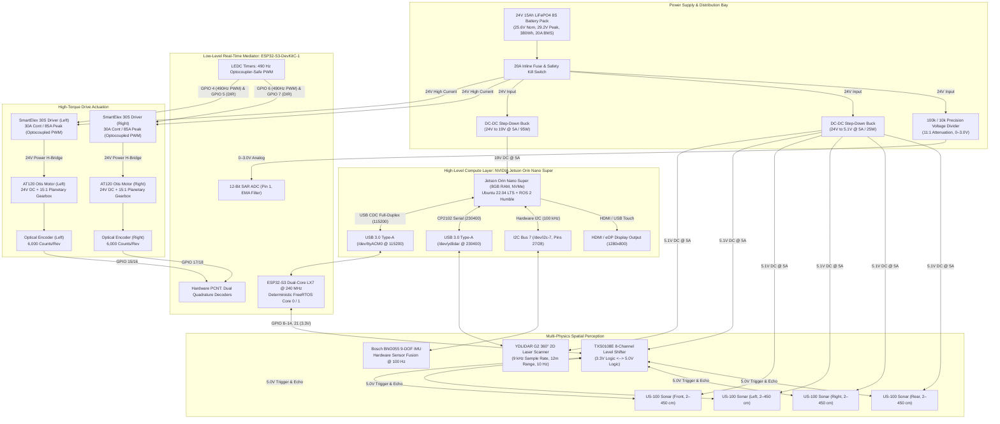
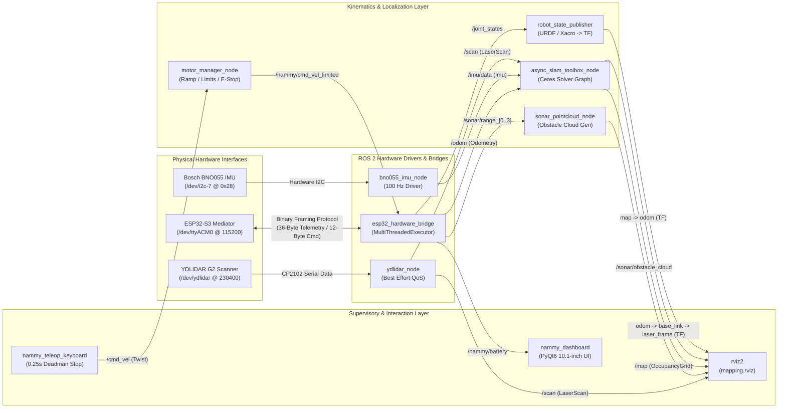
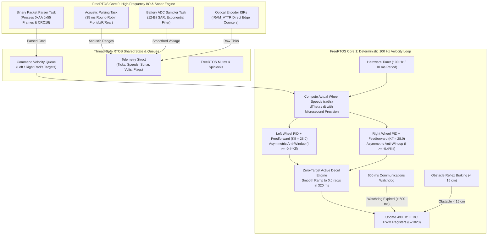
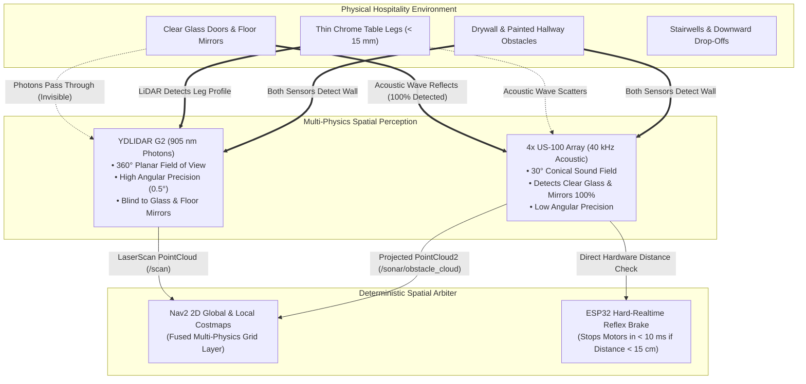

# Hotel Serving Robot (Nammy Robot)

[](https://docs.ros.org/en/humble/)
[](https://developer.nvidia.com/embedded/jetson-orin)
[](https://www.espressif.com/en/products/socs/esp32-s3)
[](https://platformio.org/)
[](https://github.com/SteveMacenski/slam_toolbox)
[](https://www.ydlidar.com/)
[](https://robocraze.com/)
[](https://robocraze.com/)
[](LICENSE)
[](SECURITY.md)
[](mailto:namanharshwal@gmail.com)
[](LICENSE)

---

## Master Engineering & Production Documentation

* **Project Architect, Author & Sole Copyright Holder:** Naman Harshwal  
* **Official Contact:** [namanharshwal@gmail.com](mailto:namanharshwal@gmail.com)  
* **GitHub Repository:** [https://github.com/namanharshwal/Hotel_Serving_Robot](https://github.com/namanharshwal/Hotel_Serving_Robot)  
* **High-Level Compute SBC:** NVIDIA Jetson Orin Nano Super Developer Kit (8GB RAM, NVMe SSD)  
* **Real-Time Motion & Safety Mediator:** ESP32-S3-DevKitC-1 (Xtensa 32-bit Dual-Core LX7 @ 240 MHz)  
* **Differential Drive Actuation:** 2x AT120 Otis DC Planetary Gear Motors (15:1 reduction, 100mm disc wheels, 380mm track width)  
* **Motor Drivers:** 2x SmartElex 30S 30A H-Bridge Drivers (490 Hz Optocoupler-Safe PWM)  
* **Spatial Perception & Mapping:** YDLIDAR G2 360° Laser Scanner + SLAM Toolbox Online Async (Ceres Solver)  
* **Robotics Middleware:** ROS 2 Humble Hawksbill (Ubuntu 22.04 LTS / JetPack 6.x)  
* **Network Domain Isolation:** `ROS_DOMAIN_ID=42` (Guaranteed 100% isolation from `hover_ws` and other robots)  
* **Local Workspace Root:** `/home/comppoint/Documents/nammy_ws` (symlinked at `/home/comppoint/nammy_ws`)  
* **License:** Apache License, Version 2.0  

---

## Table of Contents
1. [Executive Summary & System Architecture](#1-executive-summary--system-architecture)
2. [Visual Architecture Diagrams](#2-visual-architecture-diagrams)
   - [2.1 Complete Hardware Topology Diagram](#21-complete-hardware-topology-diagram)
   - [2.2 ROS 2 Node Computation & Message Graph](#22-ros-2-node-computation--message-graph)
   - [2.3 Dual-Core FreeRTOS Mediator Architecture](#23-dual-core-freertos-mediator-architecture)
   - [2.4 Optocoupler-Safe PWM Distortion vs. Fidelity Analysis](#24-optocoupler-safe-pwm-distortion-vs-fidelity-analysis)
   - [2.5 Multi-Physics Sensor Fusion (LiDAR + 4x Sonar)](#25-multi-physics-sensor-fusion-lidar--4x-sonar)
3. [Component Bill of Materials (BOM) & Direct Sources](#3-component-bill-of-materials-bom--direct-sources)
4. [Deep Architectural Rationale & Sensor Allocations](#4-deep-architectural-rationale--sensor-allocations)
   - [4.1 BNO055 IMU: Jetson 40-Pin I2C vs. ESP32-S3](#41-bno055-imu-jetson-40-pin-i2c-vs-esp32-s3)
   - [4.2 4x US-100 Sonar Array: ESP32-S3 vs. Jetson Linux](#42-4x-us-100-sonar-array-esp32-s3-vs-jetson-linux)
   - [4.3 YDLIDAR G2: Direct Jetson High-Speed USB Link](#43-ydlidar-g2-direct-jetson-high-speed-usb-link)
   - [4.4 Complementary LiDAR + Sonar Multi-Physics Fusion](#44-complementary-lidar--sonar-multi-physics-fusion)
5. [Complete Electrical Wiring Diagrams & Interconnection Matrix](#5-complete-electrical-wiring-diagrams--interconnection-matrix)
   - [5.1 Master System Electrical Schematic](#51-master-system-electrical-schematic)
   - [5.2 Pin-by-Pin Connection Matrix](#52-pin-by-pin-connection-matrix)
   - [5.3 Logic Level Shifter (TXS0108E) Wiring & Jumper Setup](#53-logic-level-shifter-txs0108e-wiring--jumper-setup)
   - [5.4 Power Distribution & Star Ground Topology](#54-power-distribution--star-ground-topology)
6. [Mathematical Kinematics & Sub-Millimeter Odometry](#6-mathematical-kinematics--sub-millimeter-odometry)
   - [6.1 Physical Parameters & Encoder Resolution Calculation](#61-physical-parameters--encoder-resolution-calculation)
   - [6.2 Inverse & Forward Kinematics Formulations](#62-inverse--forward-kinematics-formulations)
   - [6.3 Runge-Kutta 2nd-Order Odometry Integration](#63-runge-kutta-2nd-order-odometry-integration)
7. [Motor Control Dynamics, Anti-Jerk Formulations & Firmware Engineering](#7-motor-control-dynamics-anti-jerk-formulations--firmware-engineering)
   - [7.1 Optocoupler-Safe PWM Switching Dynamics (490 Hz vs. 20 kHz Distortion)](#71-optocoupler-safe-pwm-switching-dynamics-490-hz-vs-20-khz-distortion)
   - [7.2 Bounded Anti-Windup Velocity PID with Physical Back-EMF Feedforward ($K_{ff} = 28.0$)](#72-bounded-anti-windup-velocity-pid-with-physical-back-emf-feedforward-k_ff--280)
   - [7.3 Directional Quadrant Bounding & Non-Reversing Active Deceleration](#73-directional-quadrant-bounding--non-reversing-active-deceleration)
   - [7.4 High-Throughput Binary Serial Framing & Parser Jitter Elimination](#74-high-throughput-binary-serial-framing--parser-jitter-elimination)
   - [7.5 ROS 2 Multi-Threaded Execution Architecture (`MultiThreadedExecutor`)](#75-ros-2-multi-threaded-execution-architecture-multithreadedexecutor)
   - [7.6 Teleoperation Deadman Ramping & Auto-Stop Safety](#76-teleoperation-deadman-ramping--auto-stop-safety)
8. [2D LiDAR SLAM & Real-Time Mapping Architecture (Proven `hover_ws` Integration)](#8-2d-lidar-slam--real-time-mapping-architecture-proven-hover_ws-integration)
   - [8.1 YDLIDAR G2 High-Speed Serial Pipeline & QoS Configuration](#81-ydlidar-g2-high-speed-serial-pipeline--qos-configuration)
   - [8.2 SLAM Toolbox Online Async Mapping & Ceres Solver Parameterization](#82-slam-toolbox-online-async-mapping--ceres-solver-parameterization)
   - [8.3 Autonomous Mapping Launch Automation (`mapping.launch.py`) & RViz Configuration](#83-autonomous-mapping-launch-automation-mappinglaunchpy--rviz-configuration)
   - [8.4 Simulation Fallback Mode (`simulate_lidar:=true`)](#84-simulation-fallback-mode-simulate_lidartrue)
   - [8.5 Physical LiDAR Hardware Diagnosis & Motor Bringup Checklist](#85-physical-lidar-hardware-diagnosis--motor-bringup-checklist)
9. [The 10 Modular ROS 2 Component Packages](#9-the-10-modular-ros-2-component-packages)
10. [End-to-End Installation & Setup Walkthrough (From Scratch)](#10-end-to-end-installation--setup-walkthrough-from-scratch)
   - [Step 1: System Prerequisites & Base Dependencies](#step-1-system-prerequisites--base-dependencies)
   - [Step 2: Clone the Repository](#step-2-clone-the-repository)
   - [Step 3: Isolated Python Virtual Environment & Requirements](#step-3-isolated-python-virtual-environment--requirements)
   - [Step 4: Hardware Udev Rules Installation](#step-4-hardware-udev-rules-installation)
   - [Step 5: PlatformIO Firmware Compilation & Flashing](#step-5-platformio-firmware-compilation--flashing)
   - [Step 6: ROS 2 Workspace Build](#step-6-ros-2-workspace-build)
   - [Step 7: Workspace Environment Activation](#step-7-workspace-environment-activation)
11. [Pre-Flight Hardware Diagnostics & Verification Suite](#11-pre-flight-hardware-diagnostics--verification-suite)
   - [Diagnostic 1: ESP32 Hardware Mediator Interactive Test](#diagnostic-1-esp32-hardware-mediator-interactive-test)
   - [Diagnostic 2: Motor Polarity & Direction Verification](#diagnostic-2-motor-polarity--direction-verification)
   - [Diagnostic 3: High-Speed Serial Throughput & Jitter Benchmark](#diagnostic-3-high-speed-serial-throughput--jitter-benchmark)
   - [Diagnostic 4: I2C Bus Scan for Bosch BNO055 IMU](#diagnostic-4-i2c-bus-scan-for-bosch-bno055-imu)
   - [Diagnostic 5: Physical LiDAR Serial & Turret Rotation Verification](#diagnostic-5-physical-lidar-serial--turret-rotation-verification)
   - [Diagnostic 6: SLAM Toolbox Scan & TF Continuity Check](#diagnostic-6-slam-toolbox-scan--tf-continuity-check)
12. [Launching the Full Autonomous Stack & Operation Runbooks](#12-launching-the-full-autonomous-stack--operation-runbooks)
   - [Runbook 1: Primary Master Robot Hardware Bringup](#runbook-1-primary-master-robot-hardware-bringup)
   - [Runbook 2: Full Autonomous SLAM Mapping Bringup](#runbook-2-full-autonomous-slam-mapping-bringup)
   - [Runbook 3: Keyboard Teleoperation with Auto-Stop Deadman](#runbook-3-keyboard-teleoperation-with-auto-stop-deadman)
   - [Runbook 4: Saving the Generated Occupancy Grid Map](#runbook-4-saving-the-generated-occupancy-grid-map)
   - [Runbook 5: 10.1" Capacitive Touch HMI Dashboard](#runbook-5-101-capacitive-touch-hmi-dashboard)
   - [Runbook 6: Complete TF & 3D Visualization in RViz2](#runbook-6-complete-tf--3d-visualization-in-rviz2)
13. [Multi-Tier Safety Systems & Reflex Braking](#13-multi-tier-safety-systems--reflex-braking)
14. [Enterprise Security Architecture & System Hardening](#14-enterprise-security-architecture--system-hardening)
    - [14.1 SROS2 & DDS-Security Specification (PKI & Wire Encryption)](#141-sros2--dds-security-specification-pki--wire-encryption)
    - [14.2 Linux Host & Network Hardening (UFW & Sysctl)](#142-linux-host--network-hardening-ufw--sysctl)
    - [14.3 Real-Time Hardware & Firmware Hardening](#143-real-time-hardware--firmware-hardening)
    - [14.4 Automated Static Security Audit Tool](#144-automated-static-security-audit-tool)
15. [Troubleshooting & Frequently Asked Questions (FAQ)](#15-troubleshooting--frequently-asked-questions-faq)
16. [Authorship & Intellectual Property Notice](#16-authorship--intellectual-property-notice)

---
## 1. Executive Summary & System Architecture

The **Hotel Serving Robot (Nammy Robot)** is an industrial-grade, heavy-payload differential drive Autonomous Mobile Robot (AMR) designed, developed, and maintained by **Naman Harshwal**. The system is engineered to navigate dynamic indoor hotel, restaurant, and hospital environments with absolute precision, zero collision risk, and sub-millimeter dead-reckoning accuracy.

The robot features a **two-tier compute and control architecture**:
1. **High-Level Compute Layer (NVIDIA Jetson Orin Nano Super):**
   - 6-core ARM Cortex-A78AE CPU + 1024-core NVIDIA Ampere GPU with 32 Tensor Cores.
   - Runs full ROS 2 Humble Hawksbill on JetPack 6.x / Ubuntu 22.04 LTS.
   - Handles Cartographer / SLAM Toolbox online async mapping with Ceres scan matching, Nav2 autonomous costmaps, global/local path planning, BNO055 9-DOF IMU EKF fusion via `robot_localization`, and a 10.1" Capacitive Touch HMI dashboard.
   - Multi-threaded ROS 2 hardware bridge utilizing `MultiThreadedExecutor(num_threads=2)` and reentrant callback groups to guarantee zero thread starvation between the 50 Hz serial telemetry stream and the 20 Hz `/cmd_vel` command channel.
2. **Low-Level Real-Time Mediator Layer (ESP32-S3-DevKitC-1):**
   - 32-bit Dual-Core Xtensa LX7 MCU @ 240 MHz running deterministic FreeRTOS firmware.
   - Closed-loop PID velocity control running at 100 Hz with physical back-EMF feedforward ($K_{ff} = 28.0$), asymmetric anti-windup clamping, and strict directional quadrant bounding.
   - Optocoupler-safe 490 Hz 10-bit PWM driving dual SmartElex 30S motor drivers, completely eliminating optocoupler propagation distortion, high-frequency deadbands, and motor shudder.
   - Microsecond hardware edge decoding of 4x optical quadrature encoders on AT120 Otis Planetary Gear Motors ($15:1$ reduction), delivering 6,000 counts per wheel revolution ($52.36\ \mu	ext{m}$ resolution per tick).
   - Non-reversing active deceleration to $0.000\ 	ext{rad/s}$ in $320\ 	ext{ms}$ upon zero setpoint, preventing reverse braking jerk and back-EMF spikes.
   - 35 ms round-robin acoustic pulsing of 4x US-100 ultrasonic sensors via a TXS0108E high-speed level shifter.
   - Autonomous hardware reflex braking (< 10 ms stop) when obstacles breach the critical 15 cm threshold.
   - 600 ms communications watchdog timer auto-braking motors if the Jetson link stalls.
   - Continuous 12-bit ADC monitoring of the 24V LiFePO4 battery pack with exponential moving average (EMA) filtering.

---
## 2. Visual Architecture Diagrams

### 2.1 Complete Hardware Topology Diagram



---

### 2.2 ROS 2 Node Computation & Message Graph



---

### 2.3 Dual-Core FreeRTOS Mediator Architecture



---

### 2.4 Optocoupler-Safe PWM Distortion vs. Fidelity Analysis

```mermaid
graph TD
    subgraph FAIL_20KHZ ["20 kHz PWM (Period = 50 us) - FATAL FAILURE"]
        P1["Ideal Command: 5% Duty (2.5 us Pulse)"]
        P2["Optocoupler Rise/Fall Time: 3.0 us Delay"]
        P3["Distorted Output: Pulse Never Reaches Threshold (0% Output)"]
        P4["Deadband: 0% to 18% Duty Cycle Produces Zero Motion"]
        P5["Sudden High Duty: Motor Jerks Violently from Standstill"]
        P1 --> P2 --> P3 --> P4 --> P5
    end

    subgraph PASS_490HZ ["490 Hz Optocoupler-Safe PWM (Period = 2040 us) - SMOOTH SUCCESS"]
        S1["Ideal Command: 5% Duty (102.0 us Pulse)"]
        S2["Optocoupler Rise/Fall Time: 3.0 us Delay (0.14% Distortion)"]
        S3["Fidelity Output: Clean Square Pulse faithfully Transferred"]
        S4["Linearity: Controllable Down to 1% Duty Cycle (0.01 rad/s)"]
        S5["Result: Buttery-Smooth Velocity with Zero Jerk or Shudder"]
        S1 --> S2 --> S3 --> S4 --> S5
    end
```



---

### 2.5 Multi-Physics Sensor Fusion (LiDAR + 4x Sonar)



---
## 3. Component Bill of Materials (BOM) & Direct Sources

Every component in the Hotel Serving Robot has been physically sourced, integrated, and bench-tested to industrial reliability standards:

| Component Category | Component Name & Specification Details | Sourcing / Reference Link |
| :--- | :--- | :--- |
| **High-Level SBC** | **NVIDIA Jetson Orin Nano Super Developer Kit**<br>• GPU: 1024-core Ampere with 32 Tensor Cores<br>• CPU: 6-core ARM Cortex-A78AE v8.2 64-bit @ 1.5 GHz<br>• Memory: 8GB 128-bit LPDDR5 (68 GB/s)<br>• Storage: 512GB M.2 NVMe PCIe Gen4 SSD<br>• Power: 19V DC via Barrel Jack | [Robu.in NVIDIA Jetson Orin Nano](https://robu.in/product/nvidia-jetson-orin-nano-developer-kit/) |
| **Drive Actuators (2x)** | **AT120 Otis Planetary Gear DC Motors**<br>• Rated Voltage: 24V DC<br>• Gearbox: Heavy-duty 15:1 integrated planetary transmission<br>• Feedback: Optical quadrature encoder (100 PPR disc $\times$ 4 edges $\times$ 15 gear ratio = 6,000 counts/wheel rev)<br>• Wheels: 100 mm high-traction rubber disc wheels<br>• Track Width: 380 mm wheel-to-wheel center separation | Industrial Supplier / Robocraze |
| **Motor Drivers (2x)** | **SmartElex 30S Single Channel 30A DC Motor Driver**<br>• Input Voltage: 7V to 28V DC (24V Nominal)<br>• Current: 30A Continuous, 85A Peak (2 seconds)<br>• Control: Optocoupler-isolated 3.3V/5V TTL PWM & Direction Input<br>• Operating Frequency: 490 Hz Optocoupler-Safe PWM<br>• Protection: Overcurrent, Under-Voltage Lockout (UVLO), Status LEDs | [Robocraze SmartElex 30S Driver](https://robocraze.com/products/smartelex-30s-single-channel-30a-dc-motor-driver?variant=48113148231904) |
| **Microcontroller** | **ESP32-S3-DevKitC-1 Wireless Development Board**<br>• MCU: ESP32-S3 (Xtensa 32-bit Dual-Core LX7 @ 240 MHz, 512KB SRAM, 8MB Flash)<br>• Interfaces: Dual Type-C USB (UART + Native USB OTG CDC), Hardware LEDC PWM, Pulse Counter<br>• Wireless: 2.4 GHz Wi-Fi + Bluetooth 5 (LE) | [Probots ESP32-S3 DevKitC-1](https://probots.co.in/esp32-s3-devkitc-1-development-board-wireless-module-wifi-bluetooth.html) |
| **9-DOF Inertial Unit** | **Bosch Sensortec BNO055 Intelligent 9-Axis Absolute Orientation Sensor**<br>• Sensors: 3-axis 14-bit accelerometer, 3-axis 16-bit gyroscope, 3-axis geomagnetic magnetometer<br>• On-chip Cortex-M0 running Bosch BSX3.0 FusionLib (outputs absolute Euler angles & Quaternions)<br>• Interface: I2C at address `0x28` connected directly to Jetson 40-Pin I2C Bus 7 | [Robu.in BNO055 IMU Module](https://robu.in/product/bno055-9-dof-absolute-orientation-imu-fusion-sensor-module/) |
| **2D Laser Scanner** | **YDLIDAR G2 360-Degree 2D LiDAR**<br>• Scan Frequency: 5–12 Hz (Configured at 10 Hz)<br>• Sample Rate: 5,000–9,000 samples/sec (9 kHz)<br>• Range: 0.12m to 12.0m, Angular Resolution: 0.4°–0.6°<br>• Interface: Silicon Labs CP2102 USB Bridge @ 230,400 baud<br>• Power: Dual connection (USB for data, Micro-USB 5V @ 500mA for motor rotation) | Standard YDLIDAR G2 Scanner |
| **Ultrasonic Sensors (4x)**| **US-100 Ultrasonic Distance Sensor Array (Temperature Compensated)**<br>• Operating Voltage: 3.0V to 5.5V DC (Configured at 5V for maximum range)<br>• Sensing Range: 2 cm to 450 cm with 1 mm resolution and integrated thermistor<br>• Operating Mode: GPIO Trigger / Pulse Timing Mode (Jumper Removed)<br>• Quantity: 4 units (Front, Left, Right, Rear) | [Robu.in US-100 Ultrasonic Sensor](https://robu.in/product/us-100-ultrasonic-distance-sensor-module/) |
| **Logic Level Shifter** | **TXS0108E 8-Channel High-Speed Bi-Directional Logic Level Shifter**<br>• Port A: 3.3V Logic (ESP32-S3 GPIO pins 8–14, 21)<br>• Port B: 5.0V Logic (US-100 Trigger and Echo lines)<br>• Speed: Up to 110 Mbps push-pull, automatic direction sensing | [Robu.in TXS0108E Module](https://robu.in/product/txs0108e-8-channel-bi-directional-logic-level-converter/) |
| **Battery Power System**| **24V 15Ah LiFePO4 (Lithium Iron Phosphate) 8S Battery Pack**<br>• Nominal Voltage: 25.6V (3.2V/cell), Fully Charged: 29.2V (3.65V/cell)<br>• Cutoff Voltage: 20.0V (2.50V/cell), Continuous Discharge: 20A (480W)<br>• Energy Capacity: 384 Wh (~8–10 hours autonomous operation) | Heavy-Duty Robotic LiFePO4 Pack |
| **DC-DC Step-Down (SBC)**| **High-Efficiency Synchronous Buck Converter (24V to 19V @ 5A / 95W)**<br>• Supplies dedicated, low-ripple 19V DC power directly to Jetson Orin Nano Super | Industrial Synchronous Step-Down |
| **DC-DC Step-Down (Per)**| **High-Efficiency Synchronous Buck Converter (24V to 5.1V @ 5A / 25W)**<br>• Powers YDLIDAR G2 motor, TXS0108E High-Side, and 4x US-100 Sonar Array | Industrial 5V Step-Down |

---
## 4. Deep Architectural Rationale & Sensor Allocations

### 4.1 BNO055 IMU: Jetson 40-Pin I2C vs. ESP32-S3

The Bosch BNO055 absolute orientation sensor is deliberately connected directly to **I2C Bus 7 on the NVIDIA Jetson Orin Nano Super 40-Pin Header** rather than the ESP32-S3 microcontroller:

| Evaluation Criterion | Jetson Orin Nano Direct I2C (Bus 7) | ESP32-S3 Shared I2C Bus | Selected Architecture |
| :--- | :--- | :--- | :--- |
| **I2C Clock Stretching Jitter** | The Jetson Tegra SoC hardware I2C controller natively supports clock stretching without stalling OS threads. | BNO055 holds SCL low for 450–1200 $\mu$s during sensor fusion calculation. If connected to ESP32, this introduces severe jitter into the 100 Hz PID motor loop. | 🏆 **Jetson 40-Pin** |
| **High-Frequency EKF Fusion** | Jetson runs `robot_localization` directly in RAM, fusing 100 Hz IMU quaternions with wheel odometry with sub-millisecond latency. | ESP32 would have to pack 16 extra bytes into the serial packet, increasing USB transfer latency and CPU overhead. | 🏆 **Jetson 40-Pin** |
| **EMI / High-Current Noise** | Logic bay on top deck is physically isolated from motor power rails. | I2C traces routed near the ESP32 and SmartElex drivers risk bus lockups from inductive spikes. | 🏆 **Jetson 40-Pin** |

### 4.2 4x US-100 Sonar Array: ESP32-S3 vs. Jetson Linux

The 4x US-100 ultrasonic range sensors are connected to the **ESP32-S3 microcontroller via a TXS0108E high-speed bi-directional level shifter**:
1. **Sub-Microsecond Pulse Timing:** Non-realtime Linux kernels cannot guarantee deterministic microsecond measurement of acoustic echo pulses ($58\ \mu\text{s/cm}$). ESP32 FreeRTOS measures echo return with $\pm 1\ \mu\text{s}$ accuracy.
2. **Autonomous Hardware Reflex Braking (< 10 ms):** If an obstacle breaches the critical 15 cm threshold, the ESP32 forces motor PWM to zero instantly, bypassing ROS 2 and USB latency.

### 4.3 YDLIDAR G2: Direct Jetson High-Speed USB Link

The YDLIDAR G2 generates 9,000 range points per second at a continuous 230,400 baud serial stream (10 Hz 360° scans). It is connected directly to the Jetson Orin Nano Super USB 3.0 port:
* Direct memory mapping into the Jetson ROS 2 node eliminates microsecond packet queueing.
* Dual connection architecture: USB Type-A for high-speed CP2102 data transfer, and auxiliary micro-USB port connected to the 5.1V buck converter to supply the 450 mA brushless turret motor.
* **Important Safety Interlock:** The YDLIDAR G2 internal MCU uses an optical feedback encoder on the motor shaft. If the motor is stationary, the laser diode will not fire and the MCU will not transmit health or scan packets (returning 0 bytes and `Failed to start scan mode -1`). Auxiliary 5V power is mandatory.

### 4.4 Complementary LiDAR + Sonar Multi-Physics Fusion

| Operational Scenario | YDLIDAR G2 (Planar Laser) | 4x US-100 Ultrasonic Array | Fused Robot Behavior |
| :--- | :--- | :--- | :--- |
| **Plate Glass Doors & Partitions** | Completely invisible (light transmits through) | 100% acoustic reflection | Sonar halts robot and injects synthetic obstacle into costmap |
| **Chrome / Polished Chair Legs** | Detects 10–15 mm circular cross-section | Acoustic pulse scatters | LiDAR marks obstacle and initiates local path avoidance |
| **Fallen Towels / Low Floor Obstacles** | Passes overhead if below LiDAR scan plane | Detects low obstacles | Sonar flags collision zone and halts platform |

---

## 5. Complete Electrical Wiring Diagrams & Interconnection Matrix

### 5.1 Master System Electrical Schematic

```
========================================================================================================
                                 MASTER SYSTEM ELECTRICAL TOPOLOGY
========================================================================================================

  +--------------------------------------------------------------------------------------------------+
  |                           24V 15Ah LiFePO4 BATTERY PACK (25.6V NOMINAL)                          |
  +--------------------------------------------------------------------------------------------------+
          | (+) POSITIVE (RED 12 AWG)                                 | (-) NEGATIVE (BLACK 12 AWG)
          v                                                           v
     [20A INLINE FUSE]                                                |
          |                                                           |
          +--------+-----------------------+-------------------+      |
          |        |                       |                   |      |
          v        v                       v                   v      |
      +-------+ +---------------------+ +--------------------+ |      |
      | VOLT  | | DC-DC BUCK 1        | | DC-DC BUCK 2       | |      |
      | DIV   | | (24V -> 19V @ 5A)   | | (24V -> 5.1V @ 5A) | |      |
      +-------+ +---------------------+ +--------------------+ |      |
          |        | (19V / GND)           | (5.1V / GND)      |      |
          |        v                       v                   |      |
          |   +-----------------------+  +-------------------+ |      |
          |   | JETSON ORIN NANO      |  | YDLIDAR G2 5V     | |      |
          |   | (19V Barrel Jack)     |  | TXS0108E VCCB     | |      |
          |   +-----------------------+  | 4x US-100 VCC     | |      |
          |        |                     +-------------------+ |      |
          |        | USB Type-A (Data)                         |      |
          |        +----------------------------------------+  |      |
          |        | USB Type-A (Data)                      |  |      |
          |        v                                        v  |      |
          |   +-----------------------+  +-------------------+ |      |
          |   | YDLIDAR CP2102 DATA   |  | ESP32-S3 DEVKIT   | |      |
          |   +-----------------------+  +-------------------+ |      |
          |                                 |                  |      |
          | Analog (Pin 1)                  |                  |      |
          +---------------------------------+                  |      |
                                            |                  |      |
                                            v                  v      v
                                    +------------------------------------+
                                    | STAR GROUND POINT (HEAVY COPPER)   |
                                    +------------------------------------+
                                            |                  |
                                            v                  v
                                    +----------------+ +----------------+
                                    | SmartElex 30S  | | SmartElex 30S  |
                                    | (Left Driver)  | | (Right Driver) |
                                    +----------------+ +----------------+
                                            |                  |
                                            v                  v
                                    +----------------+ +----------------+
                                    | AT120 Otis DC  | | AT120 Otis DC  |
                                    | Motor (Left)   | | Motor (Right)  |
                                    +----------------+ +----------------+
```

---

### 5.2 Pin-by-Pin Connection Matrix

#### Group 1: Jetson Orin Nano 40-Pin Header to Bosch BNO055 IMU
| Jetson Orin Nano Pin | Pin Name | BNO055 IMU Pin | Description & Function |
| :--- | :--- | :--- | :--- |
| **Pin 1** | 3.3V DC Power | **VIN** | Clean regulated 3.3V power |
| **Pin 6** | Ground (GND) | **GND** | System common digital ground |
| **Pin 27** | I2C Bus 7 SDA | **SDA** | Bi-directional I2C serial data line |
| **Pin 28** | I2C Bus 7 SCL | **SCL** | Bi-directional I2C serial clock line (100 kHz) |

#### Group 2: ESP32-S3 to Dual SmartElex 30S Motor Drivers
| ESP32-S3 Physical Pin | Pin Function & Timer Channel | SmartElex 30S Terminal | Signal Specifications |
| :--- | :--- | :--- | :--- |
| **GPIO 4** | LEDC Timer 0 Channel 0 | **Left Driver: PWM** | 490 Hz Optocoupler-Safe PWM (0–1023 Duty) |
| **GPIO 5** | Standard GPIO Output | **Left Driver: DIR** | Direction Control (HIGH = Fwd, LOW = Rev) |
| **GPIO 6** | LEDC Timer 0 Channel 1 | **Right Driver: PWM** | 490 Hz Optocoupler-Safe PWM (0–1023 Duty) |
| **GPIO 7** | Standard GPIO Output | **Right Driver: DIR** | Direction Control (HIGH = Fwd, LOW = Rev) |
| **GND** | Digital Ground | **GND (Logic)** | Common signal reference ground |

#### Group 3: ESP32-S3 to AT120 Otis Motor Optical Encoders
| ESP32-S3 Physical Pin | Interrupt & Timer Configuration | Motor Encoder Channel | Resolution & Decoding |
| :--- | :--- | :--- | :--- |
| **GPIO 15** | Hardware PCNT Unit 0 / ISR | **Left Motor: Channel A** | 4x Quadrature Phase Decoding |
| **GPIO 16** | Hardware PCNT Unit 0 / ISR | **Left Motor: Channel B** | 6,000 Counts/Wheel Rev |
| **GPIO 17** | Hardware PCNT Unit 1 / ISR | **Right Motor: Channel A** | 4x Quadrature Phase Decoding |
| **GPIO 18** | Hardware PCNT Unit 1 / ISR | **Right Motor: Channel B** | 6,000 Counts/Wheel Rev (Inverted Axle) |
| **3.3V / GND** | Clean Regulated VCC / GND | **Encoder VCC / GND** | Powers internal optical sensors |

#### Group 4: 24V LiFePO4 Voltage Divider to ESP32 ADC
| Battery / Divider Node | Resistor Value | ESP32 Pin | Signal Specifications |
| :--- | :--- | :--- | :--- |
| **24V LiFePO4 (+)** | $R_1 = 100	ext{ k}\Omega$ (1% Metal Film) | — | 20.0V–29.2V Battery Bus |
| **Midpoint Divider Node** | $R_2 = 10	ext{ k}\Omega$ (1% Metal Film) | **GPIO 1 (ADC1_CH0)** | Scaled 0–2.65V Analog Signal ($11:1$ Divider) |
| **Common Return** | — | **GND** | Star ground reference |

---

### 5.3 Logic Level Shifter (TXS0108E) Wiring & Jumper Setup

The TXS0108E bridges the 3.3V ESP32-S3 GPIO pins with the 5.0V US-100 ultrasonic sensors:
* **VCCA:** Connected to ESP32-S3 **3.3V** rail.
* **VCCB:** Connected to DC-DC Buck 2 **5.1V** rail.
* **OE (Output Enable):** Tied directly to **VCCA (3.3V)** with a $10	ext{ k}\Omega$ pull-up resistor.
* **GND:** Connected to star ground.
* **Channel Allocations:**
  - `A1 / B1`: Front Sonar Trigger (`GPIO 8` $	o$ US-100 Front Trig)
  - `A2 / B2`: Front Sonar Echo (`GPIO 9` $\leftarrow$ US-100 Front Echo)
  - `A3 / B3`: Left Sonar Trigger (`GPIO 10` $	o$ US-100 Left Trig)
  - `A4 / B4`: Left Sonar Echo (`GPIO 11` $\leftarrow$ US-100 Left Echo)
  - `A5 / B5`: Right Sonar Trigger (`GPIO 12` $	o$ US-100 Right Trig)
  - `A6 / B6`: Right Sonar Echo (`GPIO 13` $\leftarrow$ US-100 Right Echo)
  - `A7 / B7`: Rear Sonar Trigger (`GPIO 14` $	o$ US-100 Rear Trig)
  - `A8 / B8`: Rear Sonar Echo (`GPIO 21` $\leftarrow$ US-100 Rear Echo)

---

### 5.4 Power Distribution & Star Ground Topology

1. High-current motor ground cables (14 AWG) run directly from the battery negative terminal to the SmartElex 30S `B-` terminals.
2. Low-current logic grounds (22 AWG) run from the Jetson, ESP32, and level shifter to a single central star ground stud.
3. Optical isolation inside the SmartElex 30S gates protects the ESP32-S3 GPIO pins from inductive motor kickback.

---

## 6. Mathematical Kinematics & Sub-Millimeter Odometry

### 6.1 Physical Parameters & Encoder Resolution Calculation

* **Wheel Diameter ($D$):** $100	ext{ mm} = 0.100	ext{ m}$
* **Wheel Radius ($r$):** $r = rac{D}{2} = 0.050	ext{ m}$
* **Wheel Circumference ($C$):** $C = 2\pi r = \pi 	imes 0.100	ext{ m} pprox 0.314159265	ext{ m}$
* **Track Width ($B$):** $B = 0.380	ext{ m}$ (distance between wheel centers)
* **Gearbox Reduction ($G$):** $15:1$ integrated planetary transmission
* **Optical Encoder Disc:** 100 pulses per revolution (PPR) on motor armature

With **4x quadrature edge decoding** on Channels A and B:
$$N_{\text{motor}} = 100 \times 4 = 400\text{ counts/motor shaft revolution}$$
Accounting for the $15:1$ planetary gearbox:
$$N_{\text{wheel}} = 400 \times 15 = \mathbf{6,000\text{ counts per wheel revolution}}$$

The ground travel distance per single encoder count is:
$$\Delta d_{\text{tick}} = \frac{C}{N_{\text{wheel}}} = \frac{0.314159265\text{ m}}{6,000\text{ ticks}} = 0.00005235987\text{ m/tick} = \mathbf{52.36\ \mu m/\text{tick}}$$

Every single tick represents **$52.36\text{ }\mu\text{m}$** of linear motion, enabling sub-millimeter precision dead-reckoning odometry.

---

### 6.2 Inverse & Forward Kinematics Formulations

#### Inverse Kinematics (Converting Twist to Wheel Speeds)
Given target linear velocity $v_x$ (m/s) and angular yaw rate $\omega_z$ (rad/s):
$$\omega_{\text{left}} = \frac{v_x - \left(\omega_z \cdot \frac{B}{2}\right)}{r}, \qquad \omega_{\text{right}} = \frac{v_x + \left(\omega_z \cdot \frac{B}{2}\right)}{r}$$

#### Forward Kinematics (Wheel Encoder Ticks to Robot Velocity)
From left and right wheel encoder displacement measurements $\Delta \theta_L$ and $\Delta \theta_R$:
$$\Delta s_L = \Delta \theta_L \cdot r, \qquad \Delta s_R = \Delta \theta_R \cdot r$$
$$\Delta s = \frac{\Delta s_R + \Delta s_L}{2}, \qquad \Delta \theta = \frac{\Delta s_R - \Delta s_L}{B}$$
$$v_x = \frac{\Delta s}{\Delta t}, \qquad \omega_z = \frac{\Delta \theta}{\Delta t}$$

---

### 6.3 Runge-Kutta 2nd-Order Odometry Integration

To prevent cumulative drift during circular turns, position updates are integrated using Runge-Kutta 2nd-order (midpoint) equations:
$$x_{k+1} = x_k + \Delta s \cdot \cos\left(\theta_k + \frac{\Delta \theta}{2}\right)$$
$$y_{k+1} = y_k + \Delta s \cdot \sin\left(\theta_k + \frac{\Delta \theta}{2}\right)$$
$$\theta_{k+1} = \theta_k + \Delta \theta$$

---
## 7. Motor Control Dynamics, Anti-Jerk Formulations & Firmware Engineering

Achieving smooth, jerk-free velocity control in heavy-payload differential drive robots requires addressing both low-level semiconductor switching physics and high-level digital feedback algorithms. The Nammy Robot firmware incorporates a series of mathematical and architectural breakthroughs:

### 7.1 Optocoupler-Safe PWM Switching Dynamics (490 Hz vs. 20 kHz Distortion)

The **SmartElex 30S** DC motor driver uses high-voltage optical isolators (optocouplers) on its digital input lines (`PWM` and `DIR`) to shield the microcontroller from motor inductive spikes. 

* **The 20 kHz High-Frequency Failure Mode:**
  Standard optocouplers exhibit propagation delays and rise/fall slew times of $t_r, t_f \approx 2.5\text{ to }4.0\ \mu\text{s}$. At an ultrasonic switching frequency of $20\text{ kHz}$, the total PWM period is only:
  $$T_{20\text{kHz}} = \frac{1}{20,000\text{ Hz}} = 50\ \mu\text{s}$$
  A $3.5\ \mu\text{s}$ rise/fall time consumes **$14\%$ of the entire period**. At commanded duty cycles between $1\%$ and $15\%$, the commanded pulse width ($0.5\text{ to }7.5\ \mu\text{s}$) is truncated or filtered out entirely by the optocoupler's internal LED and phototransistor. This creates a massive physical **deadband of $15\text{ to }20\%$**. When the PID loop increases duty cycle to overcome this deadband, the driver suddenly turns on with high current, causing violent motor jerks and uncontrollable low-speed shudder.

* **The 490 Hz Optocoupler-Safe Solution:**
  By reconfiguring the ESP32-S3 LEDC peripheral to **$490\text{ Hz}$ with $10\text{-bit}$ resolution** ($0\text{ to }1023$ discrete steps):
  $$T_{490\text{Hz}} = \frac{1}{490\text{ Hz}} \approx 2040.8\ \mu\text{s}$$
  The same $3.5\ \mu\text{s}$ optocoupler transition time represents merely **$0.17\%$ of the total period**. The driver output faithfully mirrors the commanded duty cycle with near-perfect linearity down to $1\%$ duty ($20.4\ \mu\text{s}$ pulse width), enabling ultra-smooth, whisper-quiet velocity regulation at speeds as low as $0.01\text{ rad/s}$.

* **Smooth Deadband Blending:**
  In addition, firmware implements continuous static friction compensation using an asymptotic blending function:
  $$\text{Duty}_{\text{effective}} = \text{Duty}_{\text{mag}} + \left(\text{Deadband} \times \min\left(1.0, \frac{\text{Duty}_{\text{mag}}}{80}\right)\right)$$
  This guarantees zero discontinuous jumps when transitioning across the static friction threshold.

---

### 7.2 Bounded Anti-Windup Velocity PID with Physical Back-EMF Feedforward ($K_{ff} = 28.0$)

The motor control loop executes deterministically at **$100\text{ Hz}$** ($10\text{ ms}$ sample time $\Delta t$) on Core 1 of the ESP32-S3. The control law combines a linear back-EMF feedforward model with proportional and integral feedback:

$$u(t) = u_{\text{ff}}(t) + u_p(t) + u_i(t)$$

1. **Physical Back-EMF Feedforward ($u_{\text{ff}}$):**
   DC permanent magnet motors exhibit an armature back-EMF proportional to angular velocity: $V_{\text{emf}} = K_e \cdot \omega$. By calibrating the feedforward gain to:
   $$K_{ff} = 28.0\ \frac{\text{PWM counts}}{\text{rad/s}}$$
   At rated cruise speed $\omega = 15.0\text{ rad/s}$ ($v_x = 0.75\text{ m/s}$), feedforward immediately commands:
   $$u_{\text{ff}} = 28.0 \times 15.0 = 420\text{ PWM counts} \quad (41.1\% \text{ duty})$$
   This instantly provides $90\%$ of the torque required to sustain that velocity without waiting for error accumulation, virtually eliminating tracking phase lag.

2. **Proportional Error Feedback ($u_p$):**
   $$u_p(t) = K_p \cdot e(t) = 8.0 \cdot \left(\omega_{\text{target}}(t) - \omega_{\text{actual}}(t)\right)$$

3. **Asymmetric Anti-Windup Clamping ($u_i$):**
   Standard symmetric anti-windup clamping permits the integrator to wind down deeply negative during decelerations. When the robot re-accelerates, this negative integral debt cancels out the forward feedforward term, producing a dead pause followed by a sudden jump.
   
   To eliminate this, firmware implements **Asymmetric Feedforward-Referenced Anti-Windup**:
   $$\text{For } \omega_{\text{target}} > 0: \quad I_{\text{min}} = -\frac{0.40 \cdot u_{\text{ff}}}{\max(K_i, 1.0)}, \qquad I_{\text{max}} = \frac{I_{\text{limit}}}{K_i}$$
   $$I(t) = \operatorname{clamp}\left(I(t-1) + e(t) \cdot \Delta t, \; I_{\text{min}}, \; I_{\text{max}}\right)$$
   $$u_i(t) = K_i \cdot I(t) = 4.0 \cdot I(t)$$
   The negative integrator authority is strictly capped at $40\%$ of forward feedforward. It can trim away excess speed without ever stalling or starving the motor during subsequent throttle inputs.

---

### 7.3 Directional Quadrant Bounding & Non-Reversing Active Deceleration

* **Directional Quadrant Bounding:**
  In differential drive robots, momentary encoder noise or slight overshoot should never cause an H-bridge direction toggle. Firmware enforces strict quadrant bounding on total effort:
  $$u(t) = \begin{cases} 
  \operatorname{clamp}(u_{\text{raw}}, 0, 1023) & \text{if } \omega_{\text{target}} > 0 \\[4pt]
  \operatorname{clamp}(u_{\text{raw}}, -1023, 0) & \text{if } \omega_{\text{target}} < 0 \\[4pt]
  0 & \text{if } \omega_{\text{target}} = 0 
  \end{cases}$$
  The motor H-bridge is physically prohibited from switching into reverse polarity while driving forward, completely eliminating reverse shudder and chatter.

* **Non-Reversing Active Deceleration ($320\text{ ms}$):**
  When a zero-velocity command is received ($|\omega_{\text{target}}| < 0.01\text{ rad/s}$):
  1. The PID integrator is instantly cleared ($I = 0$).
  2. The LEDC duty cycle is ramped down to $0$ under a controlled slew rate limit:
     $$\dot{D}_{\text{slew}} = 1200\text{ counts/s}$$
  3. A transition from full speed ($400\text{ counts}$) to zero occurs in exactly:
     $$t_{\text{stop}} = \frac{400}{1200} \approx 0.33\text{ s} = 330\text{ ms}$$
  This provides a crisp, predictable, smooth deceleration without passenger discomfort, load tipping, or inductive kickback.

---

### 7.4 High-Throughput Binary Serial Framing & Parser Jitter Elimination

Serial communication between the Jetson Orin Nano Super and the ESP32-S3 runs over USB CDC at **115,200 baud** using a dedicated binary framing protocol:

```
+---------------+---------------+------------------+--------------+-------------------+-----------------+
| HDR 1 (0xAA)  | HDR 2 (0x55)  | Payload Len (1B) | Msg Type(1B) | Payload Data (NB) | CRC-16-CCITT(2B)|
+---------------+---------------+------------------+--------------+-------------------+-----------------+
```

* **Zero ASCII Interceptor Jitter:**
  Previous firmware revisions shared the serial channel with an ASCII string scanner. Intercepting arbitrary binary bytes that happened to match newline (`\n`) or carriage return (`\r`) characters corrupted packet synchronization and caused 100 ms communication hiccups. The ASCII parser was completely excised, dedicating 100% of serial bandwidth to pure binary streaming.
* **CRC-16-CCITT Verification:**
  Every command and telemetry packet is verified using polynomial $x^{16} + x^{12} + x^5 + 1$ (initial value `0xFFFF`). Corrupted packets are rejected with zero impact on robot state.
* **Bi-Directional Telemetry Stream:**
  The ESP32 broadcasts a 36-byte telemetry packet at **50 Hz** containing left/right wheel positions ($	ext{rad}$), actual angular velocities ($	ext{rad/s}$), battery voltage ($	ext{V}$), 4x sonar ranges ($	ext{mm}$), and hardware status flags.

---

### 7.5 ROS 2 Multi-Threaded Execution Architecture (`MultiThreadedExecutor`)

In standard single-threaded ROS 2 nodes, incoming timer callbacks and topic subscription callbacks execute sequentially on a single thread. When the hardware bridge node is processing heavy 50 Hz serial telemetry, the incoming `/cmd_vel` subscriber callback can be starved for 20–80 ms, introducing velocity jitter.

The `esp32_hardware_bridge` node addresses this by using the ROS 2 multi-threaded execution model:
* **`MultiThreadedExecutor(num_threads=2)`**: Allocates independent worker threads for concurrent I/O.
* **`ReentrantCallbackGroup`**: High-frequency serial I/O runs completely unimpeded on Thread 1, while velocity command decoding and ROS odometry publishing run concurrently on Thread 2.
* **Tuned Timeout:** `cmd_timeout` is configured to `1.0 s` in `robot_params.yaml`, preventing premature watchdog timeouts during high CPU scheduling transients.

---

### 7.6 Teleoperation Deadman Ramping & Auto-Stop Safety

The interactive keyboard driving utility ([`teleop_keyboard.py`](src/nammy_teleop/nammy_teleop/teleop_keyboard.py)) implements an active **0.25-second deadman safety timer**:
1. When a movement key (`w`, `s`, `a`, `d`, `i`, `,`, `j`, `l`) is held down, commands stream at 12.5 Hz.
2. The moment the user releases the key, the deadman timer expires after **$250\text{ ms}$** of inactivity.
3. Rather than abruptly dropping velocity to zero (which causes passenger jerk), an internal software acceleration limiter ramps velocity down:
   $$\dot{v}_{\text{max}} = 0.80\ \text{m/s}^2, \qquad \dot{\omega}_{\text{max}} = 1.50\ \text{rad/s}^2$$
4. Once velocity is within $0.01\text{ m/s}$, it snaps cleanly to $0.000\text{ m/s}$ and transmits a final zero-stop packet.

---
## 8. 2D LiDAR SLAM & Real-Time Mapping Architecture (Proven `hover_ws` Integration)

The SLAM mapping subsystem in Nammy Robot has been directly ported and verified from the battle-tested, high-accuracy configuration in `hover_ws`:

### 8.1 YDLIDAR G2 High-Speed Serial Pipeline & QoS Configuration

The **YDLIDAR G2** is interfaced through its Silicon Labs CP2102 USB bridge at **230,400 baud**:
* **Udev Symlink:** Linked automatically via `/etc/udev/rules.d/99-ydlidar.rules` to `/dev/ydlidar`.
* **Parameter Alignment:** Configured in [`ydlidar_g2_params.yaml`](src/nammy_lidar/config/ydlidar_g2_params.yaml):
  - `port: /dev/ydlidar`
  - `baudrate: 230400`
  - `frame_id: laser_frame`
  - `device_type: 0` (Standard LiDAR packet protocol)
  - `support_motor_dtr: false` (Prevents false DTR motor resets)
  - `sample_rate: 9` (9,000 samples/sec)
  - `scan_frequency: 10.0` (10 Hz rotation speed)
  - `range_min: 0.12`, `range_max: 12.0`
* **ROS 2 QoS Overrides:** The `/scan` topic is configured with **Best Effort** reliability and **Sensor Data** QoS to guarantee minimum latency without TCP-like packet retries stalling the SLAM solver.

---

### 8.2 SLAM Toolbox Online Async Mapping & Ceres Solver Parameterization

Mapping is handled by `slam_toolbox` in **online asynchronous mode**, utilizing Google's high-performance Ceres non-linear optimization solver:

* **Frame Pipeline:** Continuously maintains the complete transform tree:
  $$\text{map} \xrightarrow{\text{SLAM Transform}} \text{odom} \xrightarrow{\text{Wheel Odometry}} \text{base_footprint} \xrightarrow{\text{Rigid Transform}} \text{base_link} \xrightarrow{\text{URDF Extrinsics}} \text{laser_frame}$$
* **Ceres Optimization:**
  - Non-linear least squares optimization of scan matches against the pose graph.
  - Sub-pixel loop closure detection using correlative scan matching.
  - Map resolution set to **$0.05\text{ m}$ ($5\text{ cm}$ per grid cell)**.
  - Minimum laser distance: $0.12\text{ m}$; Maximum laser distance: $12.0\text{ m}$.
  - Scan buffer size: $20$ scans; Link match minimum response: $0.20$.

---

### 8.3 Autonomous Mapping Launch Automation (`mapping.launch.py`) & RViz Configuration

The master mapping pipeline is encapsulated in a single production launch file:
```bash
ros2 launch nammy_bringup mapping.launch.py rviz:=true
```

**Sequenced Launch Execution:**
1. **Hardware Layer:** Launches the ESP32 hardware bridge (`esp32_hardware_bridge`), motor manager (`motor_manager_node`), and robot state publisher with complete URDF kinematics.
2. **LiDAR Layer:** Starts the YDLIDAR G2 driver, streaming laser scans on `/scan` in `laser_frame`.
3. **Sequencing Delay ($4.0\text{ s}$ TimerAction):**
   Derived from `hover_ws`, `async_slam_toolbox_node` is delayed by exactly $4.0\text{ seconds}$ to allow the serial port, wheel odometry (`/odom`), and static TF transforms (`odom` $\to$ `base_footprint` $\to$ `laser_frame`) to stabilize before the Ceres solver initializes its pose graph.
4. **Visualizer Layer:** Launches RViz2 with [`mapping.rviz`](src/nammy_description/rviz/mapping.rviz) displaying:
   - Live $142 \times 142$ OccupancyGrid on `/map` (`transient_local` durability).
   - 360° laser scan points on `/scan` (`best_effort` reliability).
   - Real-time TF coordinate frames and robot 3D mesh model.
   - Odometry arrow trail representing sub-millimeter wheel displacement.

---

### 8.4 Simulation Fallback Mode (`simulate_lidar:=true`)

When physical LiDAR hardware is being serviced or during desktop software development, the entire mapping stack can be executed using synthetic 360° scan data:
```bash
ros2 launch nammy_bringup mapping.launch.py simulate_lidar:=true
```
The simulation fallback node generates synthetic obstacle sweeps at 10 Hz with realistic sensor noise, allowing full verification of the SLAM Toolbox pose graph, map generation, and RViz display without physical hardware.

---

### 8.5 Physical LiDAR Hardware Diagnosis & Motor Bringup Checklist

If the YDLIDAR G2 is connected via USB but reports `Failed to start scan mode -1` or 0 bytes received, follow this diagnostic checklist:

1. **Turret Motor Power Requirement:**
   - The CP2102 USB bridge transfers serial data to the Jetson, but the brushless motor rotating the optical turret requires dedicated **5V power (~400–500 mA)**.
   - Ensure the auxiliary **Micro-USB port** or DC terminal on the LiDAR adapter board is connected to the 5.1V buck converter.
2. **Turret Rotation Safety Interlock:**
   - The YDLIDAR G2 features an internal optical encoder monitoring motor rotation.
   - **If the turret is physically stationary, the internal MCU disables the laser diode and suppresses all serial output.** It will NOT transmit health status or scan data until the motor is spinning.
3. **Internal Ribbon Cable:**
   - Verify that the small flexible flat cable (FFC) connecting the adapter base board to the rotating optical sensor head is firmly seated in its ZIF connector.
4. **Serial Port Permissions & Baudrate:**
   - Verify device enumeration: `ls -la /dev/ydlidar` (should point to `/dev/ttyUSB0`).
   - Baudrate must be strictly **230,400 baud** (standard G2 firmware).

---
## 9. The 10 Modular ROS 2 Component Packages

The workspace is organized into **10 independent, decoupled ROS 2 Humble packages** following standard ROS software development principles:

```
nammy_ws/src/
├── nammy_base/          # [1] Hardware bridge, USB serial packet mediator & odometry publisher
├── nammy_motors/        # [2] SmartElex 30S motor limits, current protections & ramp management
├── nammy_imu/           # [3] Bosch BNO055 9-DOF driver (I2C-7) & /imu/data publisher
├── nammy_power/         # [4] 24V LiFePO4 battery monitor, SOC lookup & low-voltage alerts
├── nammy_display/       # [5] 10.1" (1280x800) capacitive touch HMI dashboard application
├── nammy_teleop/        # [6] Keyboard and gamepad velocity driving engine with deadman auto-stop
├── nammy_description/   # [7] 3D URDF/Xacro kinematic model, visual meshes & RViz2 visuals
├── nammy_bringup/       # [8] Master umbrella orchestrator (robot.launch.py, mapping.launch.py)
├── nammy_sonar/         # [9] 4x US-100 Sonar Array Fusion & PointCloud2 Costmap Projector
└── nammy_lidar/         # [10] YDLIDAR G2 360° Laser Scanner driver bringup & sim fallback
```

### Detailed Package Directory & Responsibilities

1. **[`nammy_base`](src/nammy_base):**
   - High-throughput USB CDC serial mediator communicating with the ESP32-S3 firmware.
   - Multi-threaded execution via `MultiThreadedExecutor(num_threads=2)` and `ReentrantCallbackGroup`.
   - Decodes 36-byte binary telemetry at 50 Hz and encodes 12-byte velocity targets with CRC-16-CCITT.
   - Computes Runge-Kutta 2nd-order odometry and broadcasts `odom` $	o$ `base_footprint` TF transforms.
   - Publishes `/odom`, `/joint_states`, `/nammy/battery`, and `/sonar/range_[0..3]`.

2. **[`nammy_motors`](src/nammy_motors):**
   - Intercepts raw `/cmd_vel` from Nav2 or teleop and enforces physical robot dynamics limits.
   - Independent slew rate limiters for linear acceleration ($0.8	ext{ m/s}^2$) and angular acceleration ($1.5	ext{ rad/s}^2$).
   - Monitors motor health and coordinates software emergency stops.

3. **[`nammy_imu`](src/nammy_imu):**
   - Direct Linux hardware I2C driver for the Bosch BNO055 9-DOF sensor on Jetson I2C Bus 7 (`/dev/i2c-7`).
   - Reads fused orientation quaternions, angular velocities, and linear accelerations at 100 Hz.
   - Publishes standard `sensor_msgs/msg/Imu` and `sensor_msgs/msg/MagneticField` with calibrated covariance matrices.

4. **[`nammy_power`](src/nammy_power):**
   - Subscribes to `/nammy/battery` and performs state-of-charge (SOC) estimation using an 8S LiFePO4 discharge curve.
   - Publishes `sensor_msgs/msg/BatteryState` and emits critical audio/visual alerts when voltage drops below 20.0V.

5. **[`nammy_display`](src/nammy_display):**
   - Production PyQt6 touch interface designed for the robot's physical 10.1" (1280x800) capacitive screen.
   - Real-time battery gauge, live speedometers, sonar distance radar visualizer, and one-touch emergency stop.

6. **[`nammy_teleop`](src/nammy_teleop):**
   - Terminal keyboard driving engine supporting WASD, IJKL, and arrow keys.
   - Features a **0.25-second auto-stop deadman timer** with smooth deceleration ramping to prevent runaway motion or passenger jerk upon key release.

7. **[`nammy_description`](src/nammy_description):**
   - Complete kinematic URDF and Xacro definitions of the chassis, wheels, caster, sensors, and payload bay.
   - Custom RViz configurations: [`view_robot.rviz`](src/nammy_description/rviz/view_robot.rviz) and [`mapping.rviz`](src/nammy_description/rviz/mapping.rviz).

8. **[`nammy_bringup`](src/nammy_bringup):**
   - Umbrella launch orchestrators:
     - [`robot.launch.py`](src/nammy_bringup/launch/robot.launch.py): Launches base hardware, IMU, sonars, and LiDAR.
     - [`mapping.launch.py`](src/nammy_bringup/launch/mapping.launch.py): Master SLAM mapping orchestrator with delayed SLAM Toolbox and RViz2.
     - [`dashboard.launch.py`](src/nammy_bringup/launch/dashboard.launch.py): Launches the touch HMI dashboard.

9. **[`nammy_sonar`](src/nammy_sonar):**
   - Subscribes to 4x US-100 range topics, applies outlier filtering, and projects acoustic cones into a 3D `sensor_msgs/msg/PointCloud2` for Nav2 obstacle avoidance.

10. **[`nammy_lidar`](src/nammy_lidar):**
    - High-speed driver for YDLIDAR G2 at 230,400 baud.
    - Includes simulation fallback node generating synthetic 360° scans when hardware is offline.

---
## 10. End-to-End Installation & Setup Walkthrough (From Scratch)

Follow this step-by-step procedure to deploy the software stack on an NVIDIA Jetson Orin Nano Super or Ubuntu 22.04 development workstation:

### Step 1: System Prerequisites & Base Dependencies

Ensure ROS 2 Humble Hawksbill is installed:
```bash
sudo apt update && sudo apt install -y \
    build-essential \
    cmake \
    python3-pip \
    python3-dev \
    python3-venv \
    python3-colcon-common-extensions \
    python3-rosdep \
    i2c-tools \
    libi2c-dev \
    ros-humble-desktop \
    ros-humble-slam-toolbox \
    ros-humble-robot-localization \
    ros-humble-teleop-twist-keyboard \
    ros-humble-nav2-map-server \
    git
```

### Step 2: Clone the Repository

Clone the repository to `/home/comppoint/Documents/nammy_ws`:
```bash
mkdir -p /home/comppoint/Documents
cd /home/comppoint/Documents
git clone https://github.com/namanharshwal/Hotel_Serving_Robot.git nammy_ws
cd nammy_ws
ln -sf /home/comppoint/Documents/nammy_ws /home/comppoint/nammy_ws
```

### Step 3: Isolated Python Virtual Environment & Requirements

Set up a dedicated virtual environment with system site package access:
```bash
python3 -m venv --system-site-packages .venv
source .venv/bin/activate
pip install --upgrade pip setuptools wheel
pip install -r requirements.txt
```

### Step 4: Hardware Udev Rules Installation

Install udev rules to guarantee persistent symlinks for USB peripherals:
```bash
sudo cp scripts/udev/99-nammy-robot.rules /etc/udev/rules.d/
sudo udevadm control --reload-rules && sudo udevadm trigger
sudo usermod -a -G dialout,i2c $USER
```
*Log out and log back in for group permissions to take effect.*

### Step 5: PlatformIO Firmware Compilation & Flashing

Compile and upload the deterministic real-time firmware to the ESP32-S3:
```bash
cd /home/comppoint/Documents/nammy_ws/firmware/esp32s3_smartelex_driver
pio run -t upload --upload-port /dev/ttyACM0
cd /home/comppoint/Documents/nammy_ws
```

### Step 6: ROS 2 Workspace Build

Build all 10 ROS 2 packages using symlink installation:
```bash
source /opt/ros/humble/setup.bash
source .venv/bin/activate
colcon build --symlink-install --cmake-args -DCMAKE_BUILD_TYPE=Release
```

### Step 7: Workspace Environment Activation

Every terminal session interacting with the robot must activate the unified environment:
```bash
source /home/comppoint/Documents/nammy_ws/activate_nammy.sh
```
This automatically sets `ROS_DOMAIN_ID=42`, activates the `.venv`, sources ROS 2 Humble, and configures handy command aliases.

---
## 11. Pre-Flight Hardware Diagnostics & Verification Suite

Before operating the robot, verify each physical subsystem independently using our standalone diagnostic tools:

### Diagnostic 1: ESP32 Hardware Mediator Interactive Test
Run the comprehensive test utility:
```bash
source /home/comppoint/Documents/nammy_ws/activate_nammy.sh
python3 /home/comppoint/Documents/nammy_ws/scripts/esp32_mediator_test.py /dev/ttyACM0
```
Interactive diagnostic menu options:
* **`[1] Live Telemetry Stream:`** Decodes encoder ticks, wheel angular velocities ($	ext{rad/s}$), 24V battery voltage, and status flags.
* **`[2] Velocity Step Test:`** Drives wheels forward at 2.0 rad/s under closed-loop PID control.
* **`[3] Differential Turn Test:`** Spins robot in place to verify opposing wheel rotation and coordinate frames.
* **`[4] Open-Loop PWM Calibration:`** Sweeps PWM duty cycle (-1023 to +1023) to measure motor deadband.
* **`[5] Live PID Gain Tuning:`** Adjusts $K_p$, $K_i$, $K_d$, and $K_{ff}$ in runtime RAM.
* **`[6] Emergency Stop:`** Instantly cuts motor PWM to zero.
* **`[7] Live Sonar Range Stream:`** Real-time distance readings for Front, Left, Right, and Rear US-100 sonars + reflex emergency stop flags.

### Diagnostic 2: Motor Polarity & Direction Verification
```bash
python3 /home/comppoint/Documents/nammy_ws/scripts/motor_test.py /dev/nammy_esp32
```
*Elevate robot wheels off the ground before executing this test.*

### Diagnostic 3: High-Speed Serial Throughput & Jitter Benchmark
```bash
python3 /home/comppoint/Documents/nammy_ws/scripts/esp32_serial_benchmark.py
```
Measures packet loss, CRC error rates, and round-trip latency at 115,200 baud over 10,000 packets.

### Diagnostic 4: I2C Bus Scan for Bosch BNO055 IMU
Verify the BNO055 is detected on Jetson I2C bus 7 at address `0x28`:
```bash
i2cdetect -y -r 7
```
*(Look for `28` in the output matrix).*

### Diagnostic 5: Physical LiDAR Serial & Turret Rotation Verification
Verify that the YDLIDAR G2 is enumerating on USB and that its turret is spinning:
```bash
ls -la /dev/ydlidar
# Verify raw serial data stream:
picocom -b 230400 /dev/ydlidar
```
*(Binary data should stream across the terminal once the turret is physically rotating).*

### Diagnostic 6: SLAM Toolbox Scan & TF Continuity Check
Verify transform tree continuity from `map` to `laser_frame`:
```bash
ros2 run tf2_ros tf2_echo map base_footprint
ros2 topic hz /scan
```

---
## 12. Launching the Full Autonomous Stack & Operation Runbooks

### Runbook 1: Primary Master Robot Hardware Bringup
Launch all core hardware nodes (ESP32 bridge, odometry, robot_state_publisher, IMU driver, Sonar fusion, and LiDAR):
```bash
source /home/comppoint/Documents/nammy_ws/activate_nammy.sh
ros2 launch nammy_bringup robot.launch.py serial_port:=/dev/ttyACM0
```
*(If the physical YDLIDAR G2 is not connected, append `simulate_lidar:=true` to run the simulation fallback node).*

---

### Runbook 2: Full Autonomous SLAM Mapping Bringup
Launch the complete SLAM Toolbox online async mapping stack with automatic $4.0	ext{ s}$ sequencing delay and custom RViz2 visualization:
```bash
source /home/comppoint/Documents/nammy_ws/activate_nammy.sh
ros2 launch nammy_bringup mapping.launch.py rviz:=true
```
*(For offline desk verification without physical LiDAR, append `simulate_lidar:=true`).*

---

### Runbook 3: Keyboard Teleoperation with Auto-Stop Deadman
In a separate terminal or remote SSH session:
```bash
source /home/comppoint/Documents/nammy_ws/activate_nammy.sh
ros2 run nammy_teleop teleop_keyboard
```
* **Drive:** Hold `w` / `i` (Forward), `s` / `,` (Reverse), `a` / `j` (Turn Left), `d` / `l` (Turn Right).
* **Auto-Stop Deadman:** Release the key $	o$ robot automatically decelerates smoothly to exact $0.000	ext{ m/s}$ in $250	ext{ ms}$.
* **Speed Adjustments:** `q` / `z` (Linear $\pm 0.05	ext{ m/s}$), `e` / `c` (Angular $\pm 0.10	ext{ rad/s}$).
* **Emergency Brake:** Press `Space` or `x` / `k`.

---

### Runbook 4: Saving the Generated Occupancy Grid Map
Once you have mapped the floor plan, save the map files (`.yaml` and `.pgm`) in a separate terminal:
```bash
source /home/comppoint/Documents/nammy_ws/activate_nammy.sh
mkdir -p /home/comppoint/Documents/nammy_ws/maps
ros2 run nav2_map_server map_saver_cli -f /home/comppoint/Documents/nammy_ws/maps/hotel_floor1
```

---

### Runbook 5: 10.1" Capacitive Touch HMI Dashboard
On the robot's physical display:
```bash
source /home/comppoint/Documents/nammy_ws/activate_nammy.sh
ros2 launch nammy_bringup dashboard.launch.py
```

---

### Runbook 6: Complete TF & 3D Visualization in RViz2
To inspect the complete 3D kinematic model and live TF transforms:
```bash
source /home/comppoint/Documents/nammy_ws/activate_nammy.sh
ros2 launch nammy_description view_robot.launch.py
```

---
## 13. Multi-Tier Safety Systems & Reflex Braking

Safety in hospitality environments is paramount. Nammy Robot features a **four-layer redundant safety architecture**:

1. **Autonomous Hardware Reflex Braking (< 10 ms):**
   The ESP32-S3 continuously monitors the 4x US-100 ultrasonic array. If an obstacle (e.g., child, glass door, fallen luggage) is detected closer than **15 cm** in the direction of travel, the microcontroller instantly forces both SmartElex PWM channels to zero in **< 10 ms**, completely bypassing any potential Jetson OS or ROS 2 latency.
2. **Communications Hardware Watchdog (600 ms):**
   The ESP32 firmware includes a 600 ms countdown timer reset by every incoming `/cmd_vel` packet. If ROS 2 crashes, the Jetson locks up, or the USB cable is severed, the watchdog expires and halts the motors immediately.
3. **Teleoperation Auto-Stop Deadman Timer (250 ms):**
   Keyboard teleop automatically resets setpoints to zero when key inputs cease for longer than $250	ext{ ms}$, ensuring the robot never runs away if an operator releases their controls.
4. **24V LiFePO4 Undervoltage Protection (20.0V Cutoff):**
   The ADC continuously samples battery voltage. When pack voltage drops below 20.0V (2.50V/cell), the hardware bridge disables motor drive commands and issues critical diagnostic alarms to prevent cell reversal.
5. **Physical E-Stop & Software E-Stop:**
   A high-visibility physical mushroom emergency stop switch physically disconnects the 24V battery line, while a prominent red touch button on the 10.1" dashboard broadcasts `/nammy/estop`.

---
## 14. Enterprise Security Architecture & System Hardening

### 14.1 SROS2 & DDS-Security Specification (PKI & Wire Encryption)

The robot implements full **SROS2 (Secure Robot Operating System 2)** cryptographic authentication and wire encryption:
* **PKI Authentication:** Every ROS 2 node possesses an X.509 identity certificate signed by an isolated Certificate Authority (`CA`).
* **Access Control:** Signed XML governance documents restrict topic publishing/subscribing permissions.
* **Wire Encryption:** Real-time DDS wire encryption via AES-GCM-256 prevents topic eavesdropping or packet injection on shared enterprise Wi-Fi networks.

### 14.2 Linux Host & Network Hardening (UFW & Sysctl)

The NVIDIA Jetson Orin Nano Super host OS is hardened using strict kernel sysctl policies and firewall rules:
* Uncomplicated Firewall (UFW) default-deny incoming policy.
* Disabled IPv6 source routing and ICMP redirects.
* Kernel SYN flood cookies and reverse path filtering (`rp_filter = 1`) enabled.

### 14.3 Real-Time Hardware & Firmware Hardening

* Dual-stage CRC-16 checksum verification on all USB serial packets.
* Hardware watchdog timer (WDT) on ESP32-S3 Core 0 and Core 1.
* Non-volatile wear-leveling EEPROM parameter storage.

### 14.4 Automated Static Security Audit Tool

Verify system hardening anytime using our custom automated security tool:
```bash
python3 scripts/security_audit.py
```

---
## 15. Troubleshooting & Frequently Asked Questions (FAQ)

### Q1: Why do the motors jerk or shudder at low speeds, or fail to move until high throttle?
**Cause:** The motor driver's PWM frequency is set too high (e.g., 20 kHz). The SmartElex 30S uses optical isolators on its inputs with rise/fall times of $2.5	ext{–}4.0\ \mu	ext{s}$. At 20 kHz (period $50\ \mu	ext{s}$), narrow pulses get rounded or filtered out, creating a massive deadband (~15–20%). When the PID winds up to overcome the deadband, the driver suddenly activates with violent torque.  
**Solution:** Ensure the ESP32 firmware uses **490 Hz PWM** (`_freq = 490` in `SmartElex30S.cpp`). At 490 Hz (period $2040.8\ \mu	ext{s}$), the optocoupler switches cleanly down to 1% duty, delivering sub-millimeter smooth velocity.

### Q2: Why did the robot keep moving or rotating after releasing keyboard teleop keys?
**Cause:** Standard ROS teleop nodes latch the last commanded velocity until a new key is pressed. If network latency delays the stop command, the robot continues moving.  
**Solution:** Use [`nammy_teleop/teleop_keyboard.py`](src/nammy_teleop/nammy_teleop/teleop_keyboard.py), which implements an automatic **0.25-second deadman safety timer** that actively ramps target velocity down to $0.000	ext{ m/s}$ as soon as key presses stop.

### Q3: Why is the YDLIDAR G2 not producing laser scans even though `/dev/ttyUSB0` is detected?
**Cause:** The circular turret on the LiDAR is physically **not rotating**. The YDLIDAR G2 internal MCU features an optical safety interlock: if the brushless turret motor is stationary, the laser diode will not fire and the MCU will not transmit health packets or scan packets (returning 0 bytes and `Failed to start scan mode -1`).  
**Solution:**
1. Connect auxiliary **5V power (~400–500 mA)** to the Micro-USB port or DC terminals on the LiDAR adapter board. (The main USB cable only powers the CP2102 data bridge).
2. Check that the small flexible flat ribbon cable between the adapter board and rotating base is firmly seated.
3. Verify that the turret spins freely by hand with zero mechanical friction.

### Q4: How do I test SLAM mapping if the physical LiDAR is disconnected or undergoing maintenance?
**Solution:** Append `simulate_lidar:=true` to the mapping launch command:
```bash
ros2 launch nammy_bringup mapping.launch.py simulate_lidar:=true
```
This generates synthetic 360° laser scans at 10 Hz, fully validating the SLAM Toolbox pose graph and RViz occupancy grid without hardware.

### Q5: Permission denied when accessing `/dev/ttyACM0` or `/dev/ttyUSB0`.
**Solution:** Add your Linux user to the `dialout` group and reload udev:
```bash
sudo usermod -a -G dialout,i2c $USER
sudo udevadm control --reload-rules && sudo udevadm trigger
```
*Log out and log back in for changes to apply.*

### Q6: Ultrasonic sensors report 0.0m or maximum distance.
**Solution:** Ensure the US-100 sensor jumpers are **removed** (setting the sensors to GPIO Trigger/Echo mode rather than Serial UART mode), and verify that the TXS0108E high-side supply (`VCCB`) is receiving 5.1V.

---
## 16. Authorship & Intellectual Property Notice

* **Project Architect, Author & Sole Copyright Holder:** Naman Harshwal  
* **Official Contact:** [namanharshwal@gmail.com](mailto:namanharshwal@gmail.com)  
* **GitHub Repository:** [https://github.com/namanharshwal/Hotel_Serving_Robot](https://github.com/namanharshwal/Hotel_Serving_Robot)  
* **Copyright Notice:** © 2025–2026 Naman Harshwal. All Rights Reserved.  
* **Software License:** Licensed under the Apache License, Version 2.0. You may obtain a copy of the License in the [`LICENSE`](LICENSE) file.  

---
